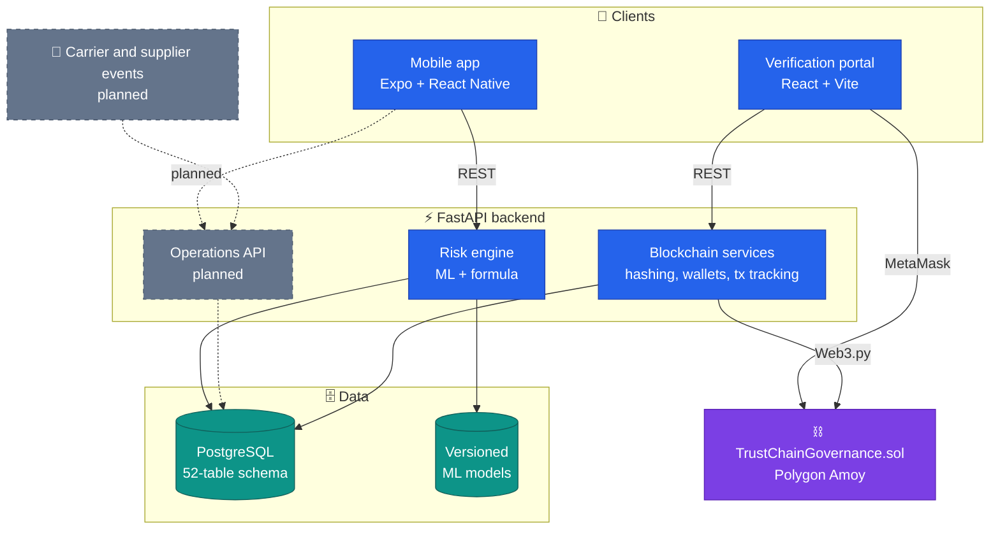
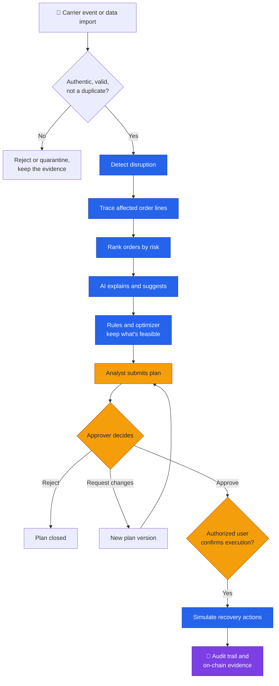
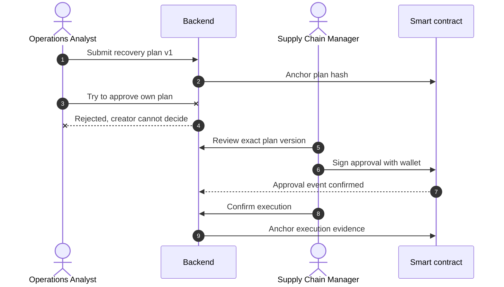
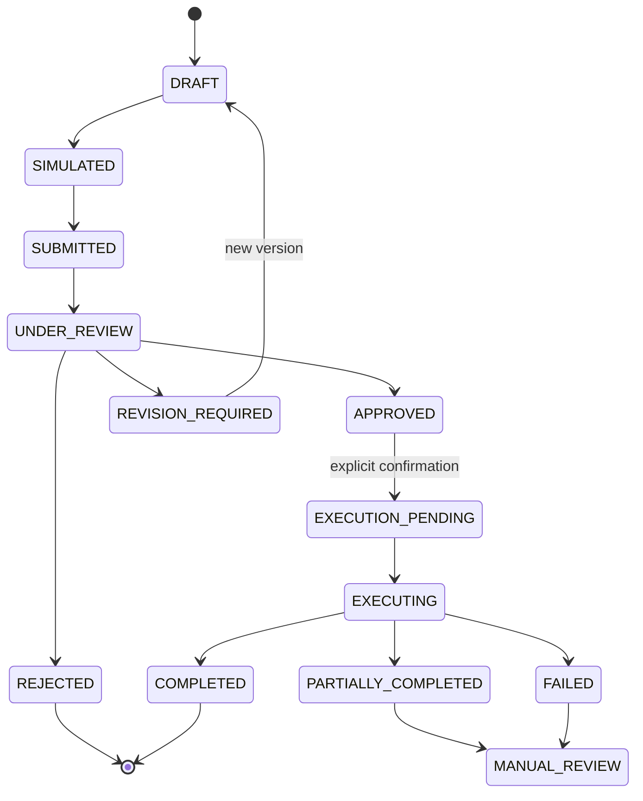
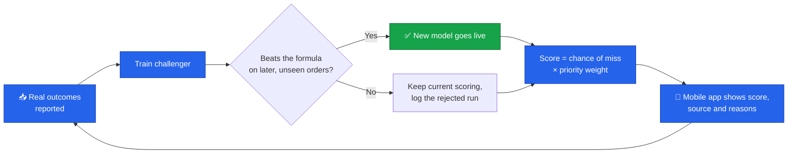
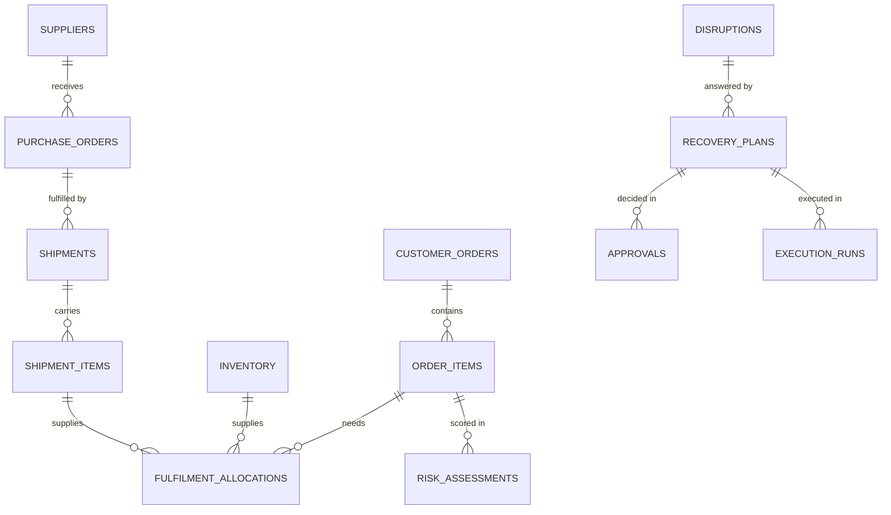
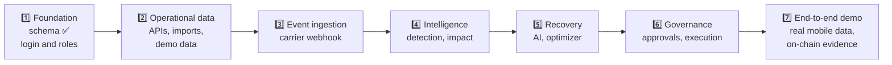

<div align="center">

# ⛓️ TRUSTCHAIN

### Don't just detect disruptions. Resolve their consequences.

AI-assisted supply chain recovery, where every decision is explainable, feasible and accountable.

<br/>


<br/>


<br/>

[The idea](#-the-idea) •
[Architecture](#%EF%B8%8F-architecture) •
[Workflow](#-workflow) •
[Risk engine](#-adaptive-risk-engine) •
[Database](#%EF%B8%8F-database) •
[Status](#-project-status) •
[Quick start](#-quick-start)

<sub>Built for the OVERCLOCK '26 Hackathon</sub>

</div>

---

## 💡 The idea

Spotting one late shipment is easy. Working out **which customer orders it really affects, what can feasibly be done, and who is allowed to decide** is the hard part.

TRUSTCHAIN turns scattered supply chain updates into one governed path, from first signal to verified outcome:

> **SENSE → CONNECT → DETECT → TRACE → PRIORITIZE → RECOMMEND → SIMULATE → OPTIMIZE → APPROVE → CONFIRM → EXECUTE → VERIFY**

| | Capability | What it means |
|---|---|---|
| 🔗 | **Connected data** | Suppliers, shipments, stock and orders linked in one model |
| 🎯 | **Real impact** | A delay only counts if it really reaches an order line |
| 🧠 | **Adaptive risk** | ML that learns from outcomes, and must beat a fixed formula to go live |
| ⚙️ | **Feasible recovery** | Rules and optimization decide what's possible; AI only advises |
| ✍️ | **Governed decisions** | Authors can't approve their own plans, and execution needs explicit confirmation |
| 🔐 | **Verifiable evidence** | Decision hashes anchored on-chain, with no personal data |

## 🏗️ Architecture

One backend serves every client. The blockchain holds evidence, never operational data.



<sub>Dashed grey boxes are specified in the PRD but not built yet.</sub>

## 🔄 Workflow

Humans stay in control: neither an AI suggestion nor a finished simulation can trigger execution.



### 🤝 Who can do what in an approval



### 🧭 Life of a recovery plan



## 🧠 Adaptive risk engine

Instead of fixing a formula forever, the model keeps learning from what really happened. It only goes live if it earns it.



- **Falls back safely:** with too little data or no proven model, scoring uses the PRD formula, `0.35D + 0.30S + 0.20I + 0.15P`.
- **Avoids leakage:** features only use outcomes known at the time of each order.
- **Explains itself:** each score lists the factors behind it and the model version that produced it.

### Results so far

| Dataset | Formula PR-AUC | ML PR-AUC | Decision |
|---|---:|---:|---|
| Synthetic demo: after a quarter of suppliers worsen | 0.558 | **0.671** | Went live |
| [DataCo](https://data.mendeley.com/datasets/8gx2fvg2k6/5) public dataset (172,765 orders) | 0.720 | **0.836** | Went live |
| Undated logistics CSV | 0.718 | 0.714 | Rejected, no real signal |

> [!IMPORTANT]
> These don't yet show ML beating the full formula in real operations. The synthetic data was built for this project and favours ML, and on DataCo the formula only had its deadline input. A fair test needs real records with all four formula inputs.

## 🗄️ Database

A multi-tenant PostgreSQL schema of **52 tables** across seven domains, managed with Alembic migrations.



Critical rules live in the database itself, so a bug in the app can't break them:

- 🚫 A plan's creator can't approve it, and the creator on an approval can't be faked
- 🧾 Audit records are append-only and hash-chained, with triggers blocking edits
- 📦 Available stock is calculated by the database, and stock can't be double-booked
- 🔁 Duplicate events, duplicate approvals and repeated execution steps are rejected

**📘 Full reference, with every domain diagram: [docs/DATABASE.md](docs/DATABASE.md)**

## 📊 Project status

| Area | State | Notes |
|---|---|---|
| Smart contract | ✅ Deployed | On Polygon Amoy; see [blockchain/README.md](blockchain/README.md) |
| Blockchain API | ✅ Built | Hashing, wallet linking, transaction tracking, verification |
| Adaptive risk engine | ✅ Built | Training, promotion gate, fallback, live scoring in the app |
| Database schema | ✅ Built | Rule tests and migrations pass on PostgreSQL 18 and SQLite |
| Login and roles | ✅ Built | Argon2, JWT and role checks for the workflow API; older risk and blockchain routes still trust headers |
| Carrier event ingestion | ✅ Built | Authenticated webhook with duplicate and out-of-order handling |
| Disruption and impact | ✅ Built | Traces delays to the order lines they really affect |
| Recovery suggestions | 🟡 Partial | Rule-checked and ranked by risk; OR-Tools and LLM summaries aren't built |
| Approvals and execution | ✅ Built | Separation of duties, simulated execution, audit chain |
| On-chain anchoring | 🟡 Partial | Code exists but hasn't been run on a live chain; the app says so until it's confirmed |
| Mobile app | 🟡 Partial | Screens for all five roles; analyst and manager flows use live data; warehouse, procurement, admin and supplier screens are still mock |

> [!WARNING]
> **Demo only.** On-chain signing uses server-held testnet wallets instead of user wallets, and all data is labelled demo data. TRUSTCHAIN is now app-only, so use Android or iOS. The web build crashes because `react-native-maps` has no web support.

## 📱 Five roles, one app

| Role | What they do in the app | Data |
|---|---|---|
| **Operations Analyst** | Investigates disruptions, reviews risk, submits recovery plans | Live |
| **Supply Chain Manager** | Approves plans, confirms execution, reviews the audit trail | Live, with some mock screens |
| **Warehouse Operator** | Scans goods, receives stock, reports damage, confirms transfers | Mock |
| **Procurement Approver** | Reviews requests and supplier alternatives, approves purchases | Mock |
| **Administrator** | Manages users, roles, facilities and integrations | Mock |

## 🚀 Quick start

**You'll need:** Python 3.11+, Node.js 20+, and Expo Go on your phone.

<details open>
<summary><b>1. Backend</b></summary>

```bash
python -m venv backend/.venv
source backend/.venv/bin/activate      # Windows: backend\.venv\Scripts\activate
pip install -r backend/requirements.txt

# Create the database, then load demo data and train the demo risk model
alembic -c backend/alembic.ini upgrade head
python -m backend.app.ops.cli seed

# Trigger the demo shipment delay at any time (seed again to reset)
python -m backend.app.ops.cli event

# Start the API, reachable from your phone. Docs at http://localhost:8000/docs
uvicorn backend.app.main:app --host 0.0.0.0 --port 8000
```

</details>

<details open>
<summary><b>2. Mobile app</b></summary>

```bash
npm install
npx expo start
```

Scan the QR code with your phone on the same Wi-Fi, and allow port 8000 through your firewall if asked. Sign in as `analyst@trustchain.com` or `manager@trustchain.com` with the demo password `password123`. If the backend is off, the app says so and labels scores as sample data.

</details>

<details>
<summary><b>3. Blockchain</b></summary>

```bash
cd blockchain
npm install
npx hardhat test
```

Deployment details are in [blockchain/README.md](blockchain/README.md).

</details>

<details>
<summary><b>4. Verification portal</b></summary>

```bash
cd blockchain/frontend
npm install
npm run dev      # http://localhost:5173
```

</details>

<details>
<summary><b>Environment variables</b></summary>

Copy [`.env.example`](.env.example) to `.env`. Everything has a local default except blockchain deployment keys, so you can skip this at first. Never commit `.env`.

</details>

## 🧪 Testing

```bash
python -m pytest backend/tests -v      # Backend, risk engine and database rules
npx tsc --noEmit                       # Mobile app types
cd blockchain && npx hardhat test      # Smart contracts
```

The backend suite has **87 tests**, and the database tests try to break each rule rather than only checking the happy path.

## 📁 Project structure

```text
.
├── src/                    # 📱 Mobile app (Expo Router)
│   ├── app/                #    Screens, grouped by role
│   └── features/           #    Analyst, manager and warehouse code
├── backend/                # ⚡ FastAPI
│   ├── app/
│   │   ├── models/         #    Database schema, by domain
│   │   ├── risk/           #    Adaptive ML risk engine
│   │   └── blockchain/     #    Hashing, wallets, transactions
│   ├── migrations/         #    Alembic migrations
│   └── tests/
├── blockchain/             # ⛓️ Solidity contract and verification portal
├── docs/DATABASE.md        # 📘 Schema reference
├── disruption.ipynb        # 🔬 Original ML exploration
└── TRUSTCHAIN_PRD_v2.0.md  # 📋 Full product specification
```

<sub>`TRUSTCHAIN_Basic_Framework/` is an early starter kept for reference only. The app doesn't use it.</sub>

## 🗺️ Roadmap



## 🔒 Security

- **Secrets stay out of git:** private keys, `.env` files and datasets are ignored.
- **No personal data on-chain:** only 32-byte hashes are anchored.
- **Non-custodial:** the backend holds no private keys, and wallets sign on the client.

## 📄 License

MIT. See [LICENSE](LICENSE).

<div align="center">
<br/>
<sub>Every disruption should lead to an understood impact, every recovery recommendation should be feasible, and every critical decision should be accountable.</sub>
</div>
