<div align="center">

#  TRUSTCHAIN (OVERCLOCK '26)
### *Next-Generation Autonomous Supply Chain Disruption Resolution & Cryptographic Governance Platform*

[](https://expo.dev)
[](https://reactnative.dev)
[](https://react.dev)
[](https://fastapi.tiangolo.com)
[](https://www.postgresql.org)
[](https://soliditylang.org)
[](https://polygon.technology)
[](https://www.typescriptlang.org)
[](https://scikit-learn.org)

<br/>

> **"Don't just detect disruptions. Resolve their consequences."**  
> *TRUSTCHAIN transforms opaque, cascading logistics delays into explainable, mathematically optimized, and cryptographically verifiable recovery plans across multi-tenant enterprise supply networks.*

</div>

---

##  Table of Contents

1. [Executive Summary & Core Value Proposition](#1-executive-summary--core-value-proposition)
2. [High-Level System Architecture](#2-high-level-system-architecture)
   - [2.1 Multi-Tier Enterprise Architecture](#21-multi-tier-enterprise-architecture)
   - [2.2 Technical Component Boundary & Network Topology](#22-technical-component-boundary--network-topology)
   - [2.3 Relational Data Architecture (52 Tables across 7 Domains)](#23-relational-data-architecture-52-tables-across-7-domains)
   - [2.4 Dual-Engine Adaptive Risk Architecture](#24-dual-engine-adaptive-risk-architecture)
   - [2.5 Decentralized Blockchain Governance & Evidence Anchoring](#25-decentralized-blockchain-governance--evidence-anchoring)
   - [2.6 Enterprise Identity, RBAC & Multi-Tenant Isolation](#26-enterprise-identity-rbac--multi-tenant-isolation)
3. [End-to-End Operational Workflows](#3-end-to-end-operational-workflows)
   - [3.1 The 12-Stage Disruption Resolution Lifecycle](#31-the-12-stage-disruption-resolution-lifecycle)
   - [3.2 Workflow 1: Real-Time Carrier Disruption Ingestion & Order Line Tracing](#32-workflow-1-real-time-carrier-disruption-ingestion--order-line-tracing)
   - [3.3 Workflow 2: Adaptive Risk Scoring & Challenger ML Promotion Gate](#33-workflow-2-adaptive-risk-scoring--challenger-ml-promotion-gate)
   - [3.4 Workflow 3: AI Recovery Optimization & What-If Simulation Engine](#34-workflow-3-ai-recovery-optimization--what-if-simulation-engine)
   - [3.5 Workflow 4: Separation-of-Duties Two-Man Governance Approval Flow](#35-workflow-4-separation-of-duties-two-man-governance-approval-flow)
   - [3.6 Workflow 5: Warehouse Ground Execution (Dock Receiving, Barcode Scanning & Quarantine)](#36-workflow-5-warehouse-ground-execution-dock-receiving-barcode-scanning--quarantine)
   - [3.7 Workflow 6: Procurement Sourcing, Matrix Comparison & Statutory ₹25L Delegation Cap](#37-workflow-6-procurement-sourcing-matrix-comparison--statutory-25l-delegation-cap)
   - [3.8 Workflow 7: Execution Confirmation & Polygon Amoy Cryptographic Anchor](#38-workflow-7-execution-confirmation--polygon-amoy-cryptographic-anchor)
4. [Screen-Based Forensic Analysis (All 5 Roles + Public Suite)](#4-screen-based-forensic-analysis-all-5-roles--public-suite)
   - [4.1 Public & Authentication Experience (6 Public Screens + 5 Portals)](#41-public--authentication-experience-6-public-screens--5-portals)
   - [4.2 Operations Analyst Experience (14 Screens)](#42-operations-analyst-experience-14-screens)
   - [4.3 Supply Chain Manager Experience (20 Screens)](#43-supply-chain-manager-experience-20-screens)
   - [4.4 Warehouse Operator Experience (15 Screens)](#44-warehouse-operator-experience-15-screens)
   - [4.5 Procurement Approver Experience (11 Screens)](#45-procurement-approver-experience-11-screens)
   - [4.6 Platform Administrator Experience (8 Screens)](#46-platform-administrator-experience-8-screens)
5. [Deep Technical Invariants & Verification Matrix](#5-deep-technical-invariants--verification-matrix)
   - [5.1 Database Triggers & Relational Invariants](#51-database-triggers--relational-invariants)
   - [5.2 Smart Contract Specification (`TrustChainGovernance.sol`)](#52-smart-contract-specification-trustchaingovernancesol)
   - [5.3 ML Model Benchmarking & PR-AUC Gate Results](#53-ml-model-benchmarking--pr-auc-gate-results)
   - [5.4 Enterprise API Endpoint Specifications](#54-enterprise-api-endpoint-specifications)
6. [Deployment, Local Development & Testing Guide](#6-deployment-local-development--testing-guide)

---

## 1. Executive Summary & Core Value Proposition

Modern supply chains are brittle, siloed, and vulnerable to catastrophic cascading delays. When a maritime carrier faces port congestion or a typhoon grounds air cargo, enterprise ERPs merely flag a delayed shipment. They fail to answer three fundamental questions:
1. **True Downstream Impact:** Which exact customer order line items and promised SLA milestones does this delay breach?
2. **Actionable Feasibility:** Can stock be transferred from a secondary regional depot, or must an alternative qualified supplier be engaged under urgent procurement?
3. **Governance & Accountability:** Who has statutory authority to approve the spend, and how is the audit trail secured against post-incident tampering?

**TRUSTCHAIN** bridges this gap by unifying five core innovations:

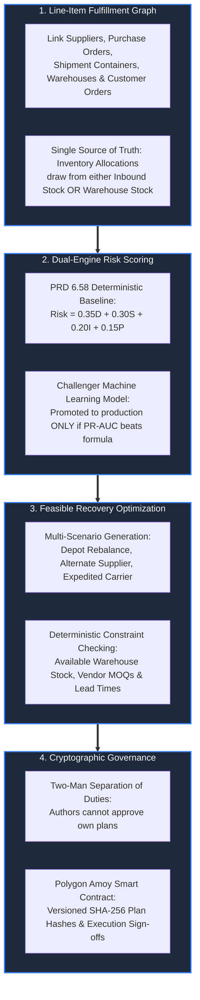

---

## 2. High-Level System Architecture

### 2.1 Multi-Tier Enterprise Architecture

The TRUSTCHAIN platform operates across a five-tier distributed architecture spanning mobile devices, edge APIs, predictive inference engines, relational databases, and decentralized blockchain networks.

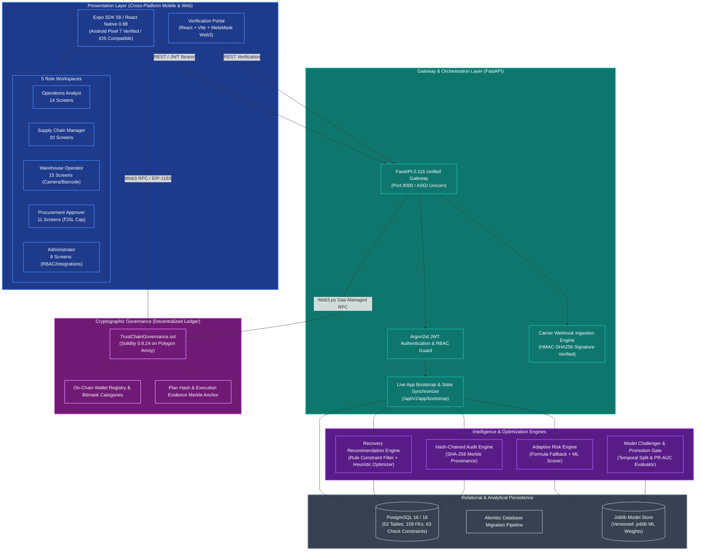

---

### 2.2 Technical Component Boundary & Network Topology

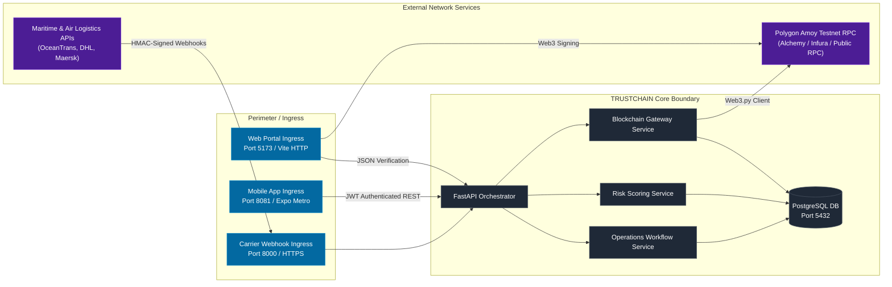

---

### 2.3 Relational Data Architecture (52 Tables across 7 Domains)

The database schema is strictly partitioned into seven distinct bounded contexts in [`backend/app/models/`](file:///d:/FIMAL/overclock/backend/app/models). The physical relationship graph below highlights the critical data pipeline connecting late shipments to affected customer order lines.

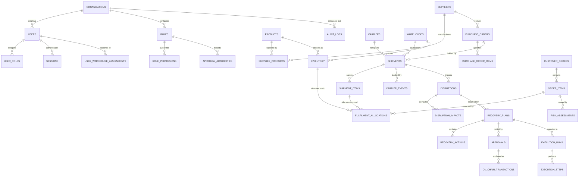

> [!IMPORTANT]
> **Mutual Exclusivity Invariant in `FULFILMENT_ALLOCATIONS`:**  
> A fulfillment allocation must draw **either** from physical stock on hand (`inventory_id`) **or** from an inbound transit shipment item (`shipment_item_id`), enforced via a strict SQL Check Constraint:  
> `CHECK ((inventory_id IS NOT NULL AND shipment_item_id IS NULL) OR (inventory_id IS NULL AND shipment_item_id IS NOT NULL))`  
> This mathematical invariant prevents phantom inventory duplication and ensures a delayed vessel *only* impacts orders explicitly linked to that consignment.

---

### 2.4 Dual-Engine Adaptive Risk Architecture

The risk scoring subsystem balances **operational safety** with **predictive accuracy**. A system should never be at the mercy of an uncalibrated machine learning model, nor should it remain tied to static formulas when real-world patterns change.

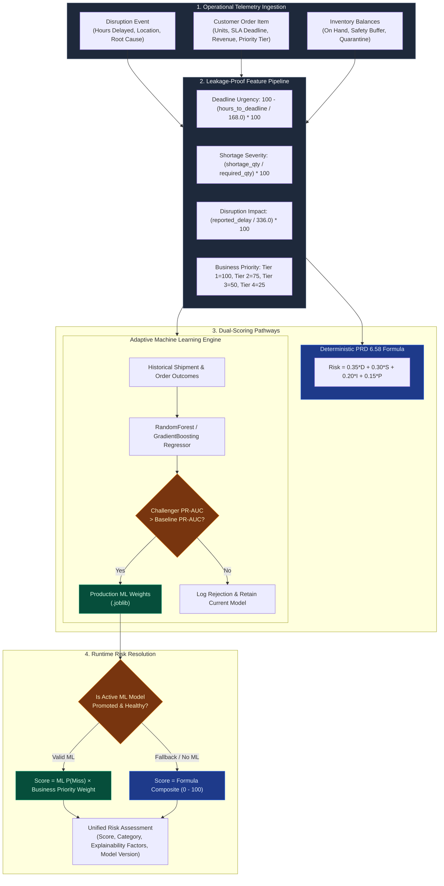

---

### 2.5 Decentralized Blockchain Governance & Evidence Anchoring

All critical governance actions are anchored onto the **Polygon Amoy Testnet** via [`TrustChainGovernance.sol`](file:///d:/FIMAL/overclock/blockchain/contracts/TrustChainGovernance.sol). To ensure maximum enterprise privacy and GDPR compliance, zero PII or operational payloads are stored on-chain. Only 32-byte cryptographic hashes are anchored.

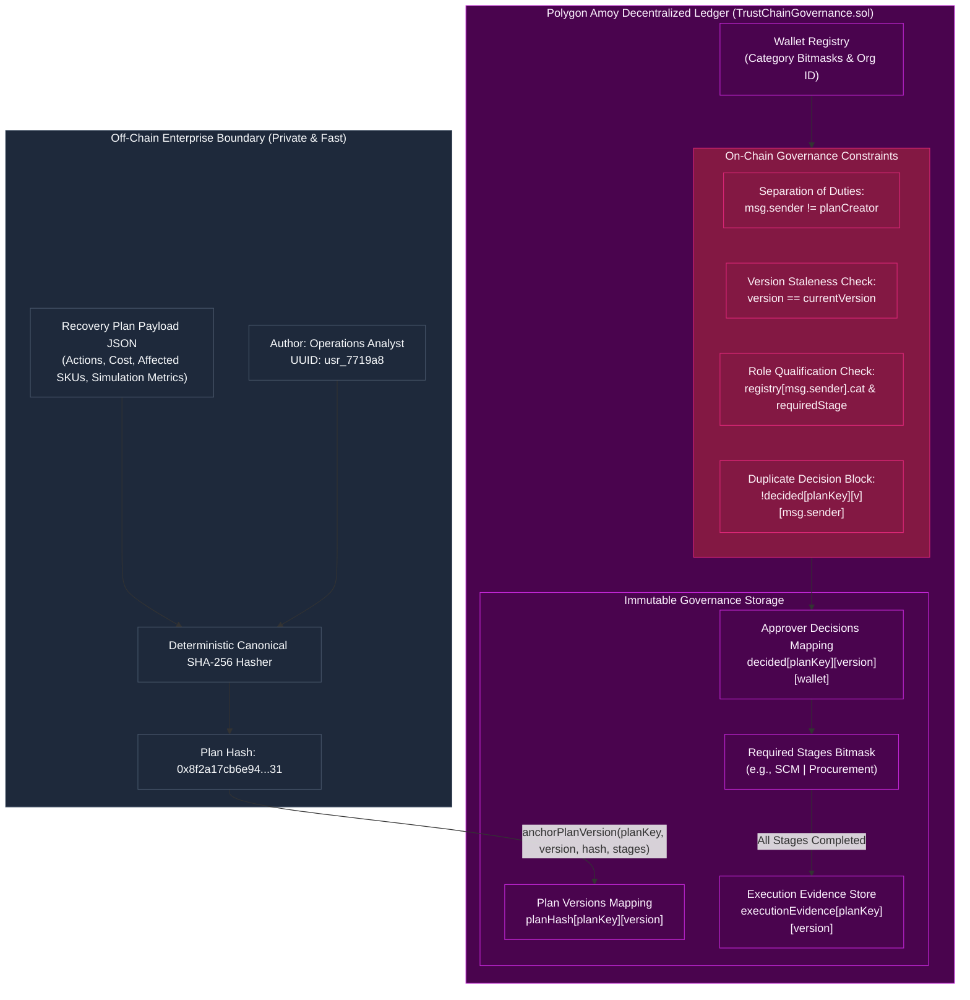

---

### 2.6 Enterprise Identity, RBAC & Multi-Tenant Isolation

TRUSTCHAIN enforces strict tenant separation and zero-trust role segregation. An actor assigned to one role cannot execute actions assigned to another:

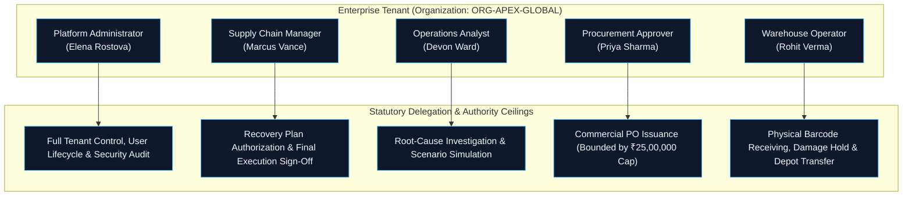

---

## 3. End-to-End Operational Workflows

### 3.1 The 12-Stage Disruption Resolution Lifecycle

Every real-world disruption moves through twelve strictly governed stages:

```mermaid
flowchart LR
    S1["1. SENSE<br/>Carrier Webhook"] --> S2["2. CONNECT<br/>Line-Item Graph"]
    S2 --> S3["3. DETECT<br/>Delay Threshold"]
    S3 --> S4["4. TRACE<br/>Downstream Order"]
    S4 --> S5["5. PRIORITIZE<br/>Risk Score / SLA"]
    S5 --> S6["6. RECOMMEND<br/>AI / Optimization"]
    S6 --> S7["7. SIMULATE<br/>Cost / Time / Feas."]
    S7 --> S8["8. OPTIMIZE<br/>Constraint Sift"]
    S8 --> S9["9. APPROVE<br/>Separation of Duty"]
    S9 --> S10["10. CONFIRM<br/>Manager Execution"]
    S10 --> S11["11. EXECUTE<br/>Ground Operations"]
    S11 --> S12["12. VERIFY<br/>Polygon Amoy Proof"]

    classDef step fill:#1E293B,stroke:#0EA5E9,color:#FFFFFF,stroke-width:2px;
    class S1,S2,S3,S4,S5,S6,S7,S8,S9,S10,S11,S12 step;
```

---

### 3.2 Workflow 1: Real-Time Carrier Disruption Ingestion & Order Line Tracing

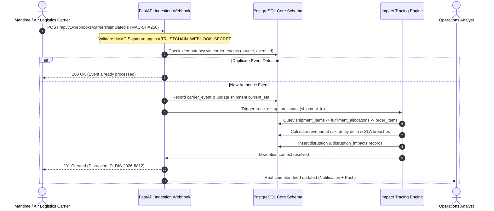

---

### 3.3 Workflow 2: Adaptive Risk Scoring & Challenger ML Promotion Gate

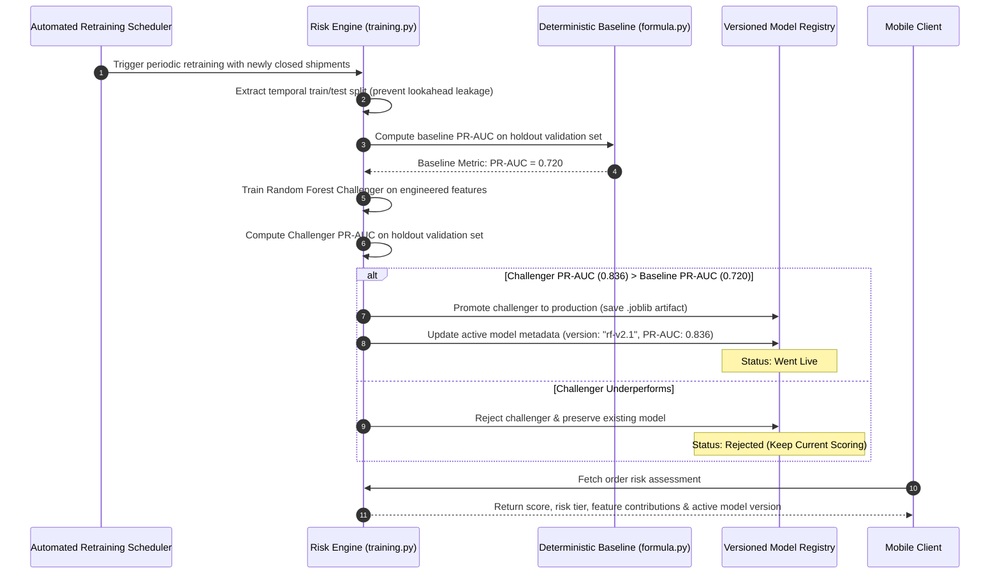

---

### 3.4 Workflow 3: AI Recovery Optimization & What-If Simulation Engine

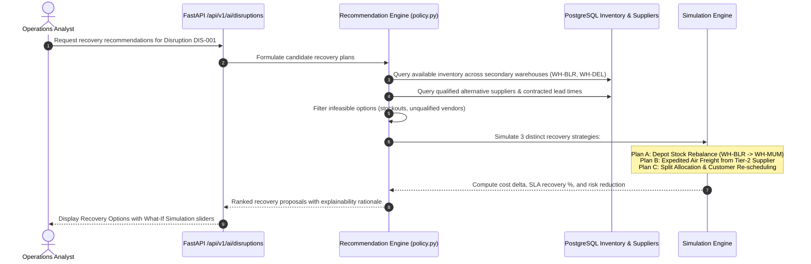

---

### 3.5 Workflow 4: Separation-of-Duties Two-Man Governance Approval Flow

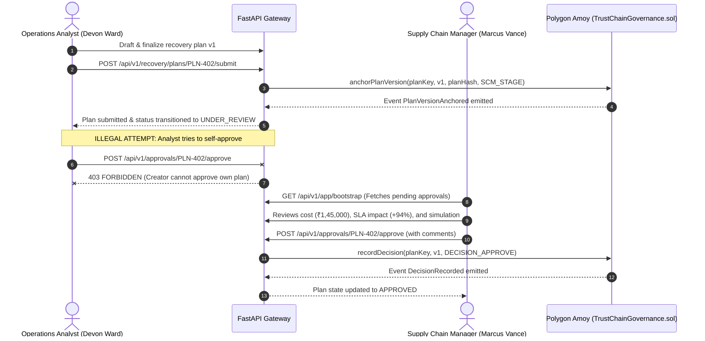

---

### 3.6 Workflow 5: Warehouse Ground Execution (Dock Receiving, Barcode Scanning & Quarantine)

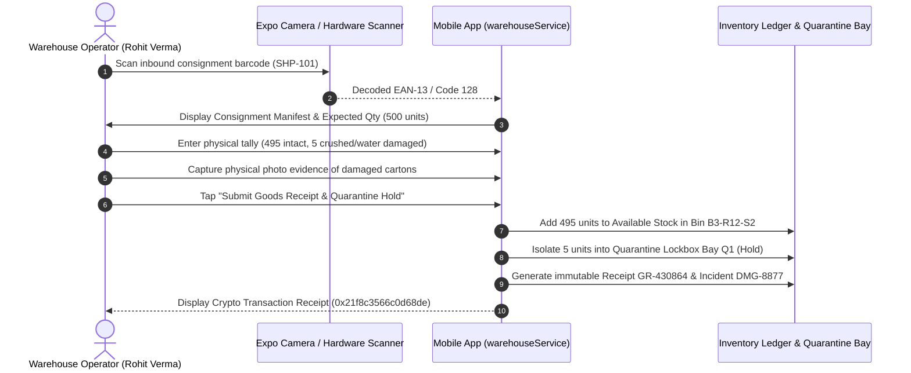

---

### 3.7 Workflow 6: Procurement Sourcing, Matrix Comparison & Statutory ₹25L Delegation Cap

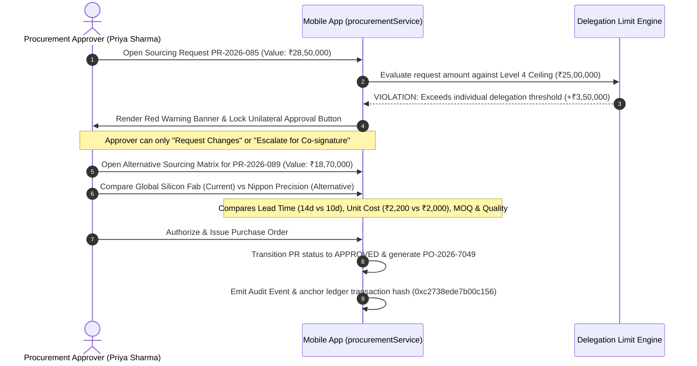

---

### 3.8 Workflow 7: Execution Confirmation & Polygon Amoy Cryptographic Anchor

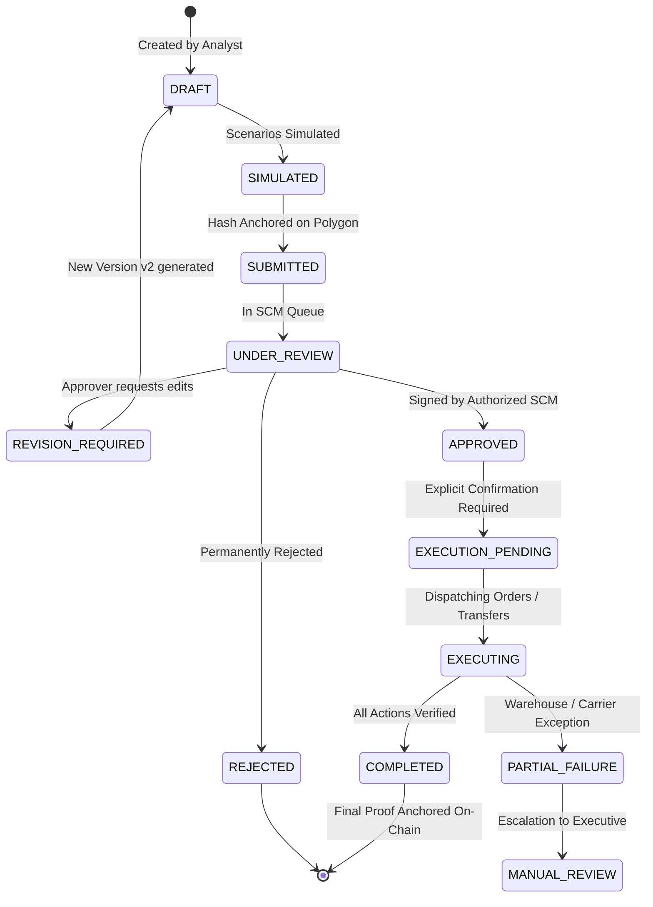

---

## 4. Screen-Based Forensic Analysis (All 5 Roles + Public Suite)

TRUSTCHAIN's frontend comprises **91 total route files** in [`src/app/`](file:///d:/FIMAL/overclock/src/app) (**73 dedicated interactive screens** and **18 layout navigators**), strictly typed and running on Expo Router SDK 58.

---

### 4.1 Public & Authentication Experience (6 Public Screens + 5 Portals)

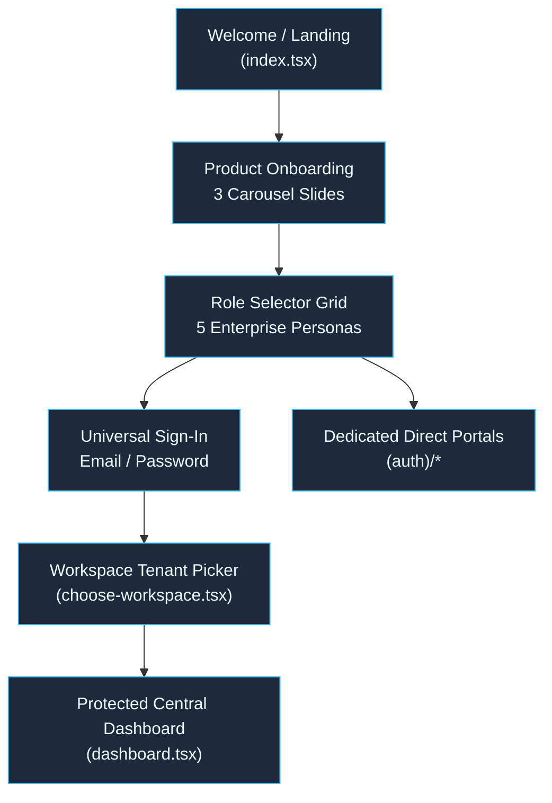

#### Screen Catalog & Forensic Details:
1. **Welcome / Landing (`src/app/index.tsx`)**: Enterprise brand splash, value proposition showcase, animated login CTA, and system status indicator.
2. **Onboarding Carousel (`src/app/(public)/onboarding.tsx`)**: 3-step interactive feature progression highlighting Line-Item Tracing, Machine Learning Risk Scoring, and Cryptographic Governance.
3. **Role Selection Grid (`src/app/(public)/role-selection.tsx`)**: Visual enterprise card grid displaying credentials, duties, and demo login shortcuts for all 5 enterprise personas.
4. **Universal Sign-In (`src/app/(public)/signin.tsx`)**: Argon2id password authentication, email validation, session token issuance, and SecureStore hardware key persistence.
5. **Registration (`src/app/(public)/signup.tsx`)**: Multi-tenant employee provisioning and organizational domain assignment.
6. **Password Recovery (`src/app/(public)/forgot-password.tsx`)**: Secure token request and password reset workflow.
7. **Workspace Tenant Picker (`src/app/(public)/choose-workspace.tsx`)**: Multi-facility context switcher allowing users to select active organizational units (e.g., `ORG-APEX-GLOBAL`).
8. **Role-Specific Auth Portals (`src/app/(auth)/[role].tsx`)**:
   - `operations-analyst.tsx`: Pre-filled demo credentials for Devon Ward (`analyst@trustchain.com`).
   - `supply-chain-manager.tsx`: Pre-filled demo credentials for Marcus Vance (`manager@trustchain.com`).
   - `warehouse-operator.tsx`: Pre-filled demo credentials for Rohit Verma (`warehouse@trustchain.com`).
   - `procurement-approver.tsx`: Pre-filled demo credentials for Priya Sharma (`procurement@trustchain.com`).
   - `administrator.tsx`: Pre-filled demo credentials for Elena Rostova (`admin@trustchain.com`).

---

### 4.2 Operations Analyst Experience (14 Screens)

The Operations Analyst workspace (`src/app/(protected)/operations-analyst/`) is dedicated to root-cause investigation, downstream impact propagation, and scenario simulation.

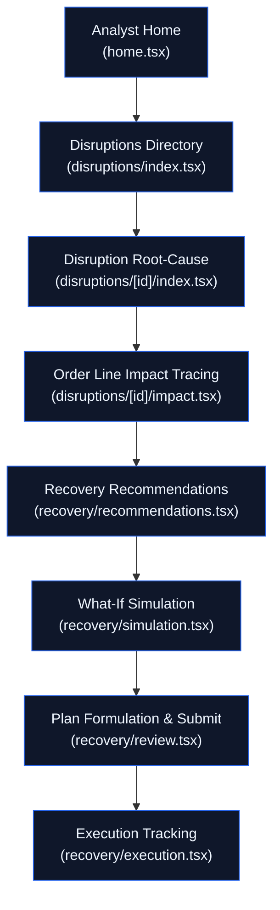

#### Detailed Screen Breakdown:
1. **Analyst Command Home (`home.tsx`)**:
   - **UI Hierarchy:** Navy header (`#10234D`), disruption summary chips (Critical: 2, High: 3, Moderate: 1), active affected order counters, and disruption feed with severity pills.
   - **Data Binding:** Synchronized to `operationsService` observable store and live `/api/v1/app/bootstrap` endpoint via `backendSync.ts`.
2. **Disruptions Feed & Directory (`disruptions/index.tsx`)**:
   - Multi-parameter search bar, category chips (`All`, `Shipment`, `Supplier`, `Inventory`), and severity badges (`Critical`, `High`, `Moderate`, `Low`).
3. **Disruption Root Cause & Dossier (`disruptions/[id]/index.tsx`)**:
   - Detailed breakdown of delayed vessel/flight, origin, destination port, delay delta (e.g., +96h), and carrier telemetry notes.
4. **Line-Item Impact Tracing (`disruptions/[id]/impact.tsx`)**:
   - Visual dependency graph linking carrier shipment items to customer order line items. Displays total units at risk and SLA breach probabilities.
5. **Predictive Risk Analysis (`risk.tsx`)**:
   - Interactive SVG Risk Donut Chart illustrating risk score distribution across the four formula components (Deadline, Shortage, Disruption, Priority).
6. **Affected Orders Directory (`orders.tsx`)**:
   - Tabular directory of individual customer order lines with customer tiering (Tier 1 Enterprise vs Tier 4 Standard) and revenue impact.
7. **Recovery Recommendations Hub (`recovery/recommendations.tsx`)**:
   - AI-assisted recovery actions grouped into Depot Stock Rebalancing, Alternative Vendor Sourcing, and Carrier Rerouting.
8. **What-If Simulation Engine (`recovery/simulation.tsx`)**:
   - Interactive recovery sliders allowing analysts to model cost trade-offs vs SLA recovery percentages before plan finalization.
9. **Plan Formulation & Submission (`recovery/review.tsx`)**:
   - Plan summary dossier, required approval stage configuration, and cryptographic hash anchoring invocation. Enforces mandatory review notes.
10. **Plan Execution Monitoring (`recovery/execution.tsx`)**:
    - Real-time step progress tracker showing milestone completion across participating warehouses and carriers.
11. **Notifications Center (`notifications.tsx`)**:
    - Critical alerts feed with instant deep-linking to newly flagged disruptions.
12. **Analyst Profile & Security (`profile.tsx`)**:
    - Hardware session management, active JWT credentials, role verification badge, and secure sign-out.

---

### 4.3 Supply Chain Manager Experience (20 Screens)

The Supply Chain Manager suite (`src/app/(protected)/supply-chain-manager/`) provides executive oversight, geospatial logistics tracking, and multi-tier approval governance.

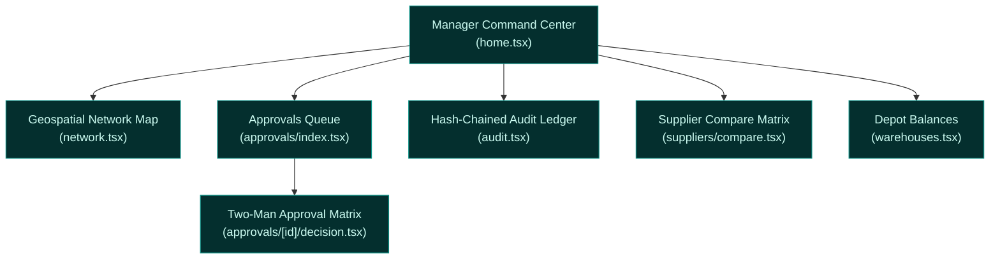

#### Detailed Screen Breakdown:
1. **Executive Operations Command (`home.tsx`)**:
   - High-level KPIs: Global Network Health (92.4%), Pending Approvals (3), Active Disruptions (4), and On-Chain Anchored Plans (12).
2. **Interactive Geospatial Network Map (`network.tsx`)**:
   - Live multi-tier logistics mapping with precalculated great-circle maritime and air routes (`precalculatedRoutes.json`), harbor pins, and bottleneck markers.
3. **Approvals Management Queue (`approvals/index.tsx`)**:
   - Filterable queue of submitted recovery plans awaiting managerial sign-off. Highlights financial cost, SLA impact, and plan creator.
4. **Two-Man Approval & Co-signing Modal (`approvals/[id]/decision.tsx`)**:
   - Executive decision interface. Enforces **Separation of Duties** (blocks approval if the manager authored the plan). Options: `Approve`, `Request Revision`, `Reject`.
5. **Hash-Chained Audit Trail (`audit.tsx`)**:
   - Immutable timeline of organizational actions. Displays previous hash, current block hash, actor identity, and Polygon transaction links.
6. **Supplier Reliability & Benchmarking (`suppliers/index.tsx` & `[id].tsx`)**:
   - Supplier dossiers tracking on-time delivery (OTD %), quality defect PPM, and active purchase order obligations.
7. **Head-to-Head Supplier Comparison (`suppliers/compare.tsx`)**:
   - Side-by-side benchmarking of primary vs contingency suppliers.
8. **Warehouse Network Directory (`warehouses.tsx`)**:
   - Inventory levels, available storage capacity, and quarantine hold tallies across global regional distribution centers (`WH-MUM`, `WH-BLR`, `WH-DEL`).

---

### 4.4 Warehouse Operator Experience (15 Screens)

The Warehouse Operator suite (`src/app/(protected)/warehouse-operator/`) interfaces directly with native physical device hardware, enabling camera barcode scanning, photo evidence capture, and quarantine segregation.

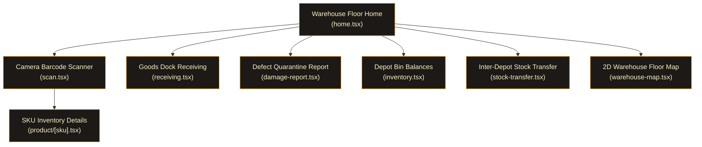

#### Detailed Screen Breakdown:
1. **Warehouse Floor Command (`home.tsx`)**:
   - Shift KPIs (Pending Picks: 8, Inbound Docks: 3, Active Transfers: 2, Stock Under QA: 60 units), operator shift card, and emergency disruption alert banner.
2. **Barcode & QR Camera Scanner (`scan.tsx`)**:
   - Native hardware viewfinder via `expo-camera`, torch toggle, target reticle, multi-format decoder (EAN-13, QR, Code 128), and manual SKU entry fallback.
3. **Product Inventory Dossier (`product/[sku].tsx`)**:
   - Complete SKU breakdown: Total Units, Available, Reserved, Quarantined, Unit Cost, and exact 2D Storage Coordinates (`Aisle B3 · Rack 12 · Shelf 2`).
4. **Dock Goods Receiving (`receiving.tsx`)**:
   - Inbound consignment tally, tamper seal verification, physical quantity stepper, defect tally, and cryptographic receipt generation (`GR-430864`).
5. **Defect & Damage Quarantine Report (`damage-report.tsx`)**:
   - Mandatory quarantine segregation protocol. Photo evidence uploader (`expo-image-picker`), defect taxonomy (Physical, Water, Packaging), and automatic transfer to Quarantine Bay Q1.
6. **Depot Inventory Ledger (`inventory.tsx`)**:
   - Bin-level ledger tracking available vs quarantined units with search and filter tabs (`All`, `In Stock`, `Low Stock`, `Quarantined`).
7. **Inter-Depot Stock Transfer Request (`stock-transfer.tsx`)**:
   - Dual-signoff inter-depot rebalancing interface (`WH-MUM` to `WH-BLR`). Automatically dispatches approval requests to the Supply Chain Manager.
8. **2D Spatial Warehouse Floor Plan (`warehouse-map.tsx`)**:
   - Interactive SVG floor map rendering aisles A1-C1, receiving bays 01-02, dispatch staging gates, and quarantine holding pens.

---

### 4.5 Procurement Approver Experience (11 Screens)

The Procurement Approver suite (`src/app/(protected)/procurement-approver/`) operates with a dedicated visual design system (Procurement Purple `#8B5CF6`) and enforces strict financial governance.

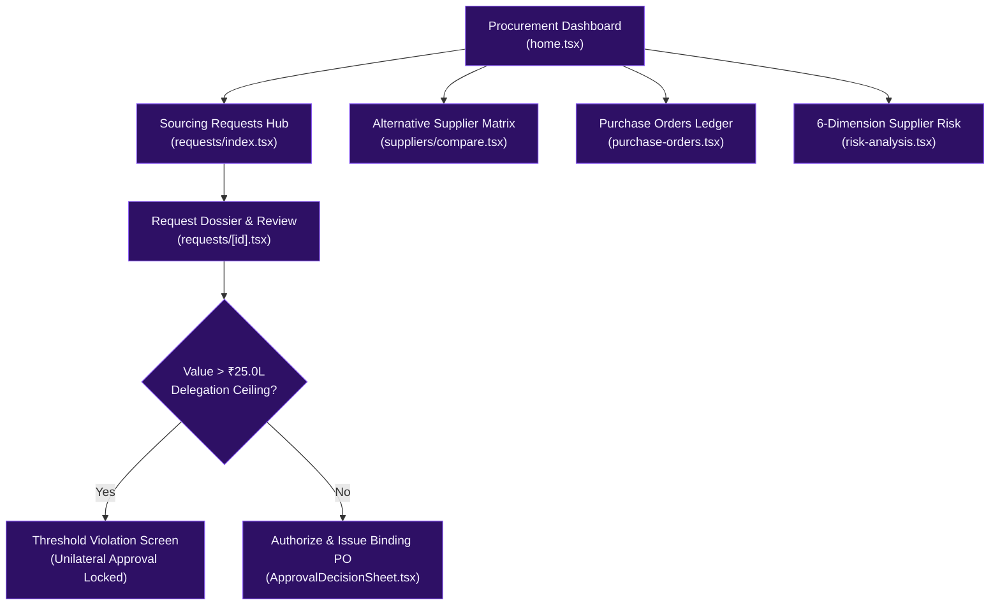

#### Detailed Screen Breakdown:
1. **Procurement Executive Dashboard (`home.tsx`)**:
   - Telemetry: Pending Value (₹68.4L), Approved Today (₹24.5L), Active Suppliers (18), and High-Risk Suppliers (3). Disruption sourcing banner and quick station tiles.
2. **Sourcing Requests Directory (`requests/index.tsx`)**:
   - Searchable directory of emergency sourcing requests with status tabs (`All`, `Pending`, `Approved`, `Rejected`), priority pills, and threshold warning ribbons.
3. **Request Dossier & Threshold Violation (`requests/[id].tsx`)**:
   - Comprehensive request breakdown. Automatically evaluates request value against the Level 4 ₹25,00,000 ceiling. Disables unilateral approval for requests exceeding the cap.
4. **Head-to-Head Alternative Sourcing Matrix (`suppliers/compare.tsx`)**:
   - Multi-metric benchmark evaluating Lead Time, Unit Price, Weekly Capacity, MOQ, Qualification Status, SLA %, Quality Score, and Risk Index.
5. **Binding Purchase Order Ledger (`purchase-orders.tsx`)**:
   - Formal PO tracking with Incoterms, line items, cryptographic ledger hashes, and approver cancellation governance.
6. **Composite Supplier Risk Index (`risk-analysis.tsx`)**:
   - 6-dimension risk analysis covering Geopolitical, Lead-Time, Concentration, Financial, Capacity, and Quality vulnerabilities.

---

### 4.6 Platform Administrator Experience (8 Screens)

The Platform Administrator suite (`src/app/(protected)/administrator/`) provides complete governance over tenant configuration, identity provisioning, and external integrations.

```mermaid
flowchart TD
    ADM_HOME["Admin Master Hub<br/>(home.tsx)"] --> USERS["User Provisioning & Roles<br/>(users.tsx & roles.tsx)"]
    ADM_HOME --> ORGS["Multi-Tenant Config<br/>(organizations.tsx)"]
    ADM_HOME --> INTEGRATIONS["Enterprise Webhooks & ERP<br/>(integrations.tsx)"]
    ADM_HOME --> POLICIES["Risk Policies & Limits<br/>(policies.tsx)"]
    ADM_HOME --> HEALTH["System Telemetry & Health<br/>(system-health.tsx)"]
    ADM_HOME --> AUDIT["Security Audit Trail<br/>(audit.tsx)"]

    classDef admStyle fill:#1E1B4B,stroke:#6366F1,color:#EEF2FF;
    class ADM_HOME,USERS,ORGS,INTEGRATIONS,POLICIES,HEALTH,AUDIT admStyle;
```

#### Detailed Screen Breakdown:
1. **Administration Command Hub (`home.tsx`)**:
   - System KPIs (Total Users: 24, System Uptime: 99.94%, Registered Warehouses: 4, Active Disruptions: 3), security health cards, and module shortcuts.
2. **User Management & Identity Provisioning (`users.tsx`)**:
   - Complete user lifecycle management: status toggling (`active`, `suspended`), role assignments, warehouse stationing, and multi-factor authentication controls.
3. **Role-Based Access Control Matrix (`roles.tsx`)**:
   - Permission bitmask inspection and custom role capability assignment across all 5 enterprise personas.
4. **Multi-Tenant Organization Configuration (`organizations.tsx`)**:
   - Enterprise workspace boundaries, legal entity metadata, and tenant isolation parameters.
5. **External Enterprise Integrations (`integrations.tsx`)**:
   - Webhook configurations for maritime carriers (OceanTrans, Maersk) and ERP connectors (SAP S/4HANA, Oracle SCM) with health pings and shared secret management.
6. **Risk Policy Parameters & Thresholds (`policies.tsx`)**:
   - Runtime configuration for statutory delegation caps (e.g., ₹25.0L ceiling), risk formula weights, and automated escalation thresholds.
7. **System Health & Service Telemetry (`system-health.tsx`)**:
   - Real-time telemetry monitoring FastAPI latency, PostgreSQL connection pool depth, and Polygon Amoy gas price levels.
8. **Platform Security Audit Trail (`audit.tsx`)**:
   - Forensic administrative audit log tracking user logins, role modifications, and policy updates.

---

## 5. Deep Technical Invariants & Verification Matrix

### 5.1 Database Triggers & Relational Invariants

Critical business rules are implemented at the PostgreSQL database layer, guaranteeing that bugs in the application layer cannot corrupt the ledger:

| Invariant Rule | Implementation Mechanism | Enforcement Behavior |
|---|---|---|
| **Separation of Duties** | SQL Check & Trigger on `approvals` | Rejects any approval record where `approver_id == plan.created_by`. |
| **Tamper-Proof Audit Trail** | Hash-Chained Trigger on `audit_logs` | Automatically computes `SHA256(prev_hash + timestamp + payload)`. Blocks `UPDATE` and `DELETE` queries. |
| **Stock Double-Booking Prevention** | Check Constraint on `fulfilment_allocations` | `allocated_quantity <= inventory.available_quantity`. Prevents negative inventory balances. |
| **Fulfillment Exclusivity** | Check Constraint on `fulfilment_allocations` | `(inventory_id IS NOT NULL AND shipment_item_id IS NULL) OR (inventory_id IS NULL AND shipment_item_id IS NOT NULL)`. |
| **Idempotent Webhooks** | Composite Unique Index on `carrier_events` | `UNIQUE(source, event_id)`. Rejects duplicate webhook payloads instantly. |

---

### 5.2 Smart Contract Specification (`TrustChainGovernance.sol`)

The on-chain governance contract enforces versioned state transitions on Polygon Amoy:

```solidity
// Canonical plan status state transitions enforced on Polygon Amoy
enum PlanStatus {
    NONE,               // 0: Unanchored
    PENDING_APPROVAL,   // 1: Anchored, awaiting required stage sign-offs
    APPROVED,           // 2: All required stage approvals recorded
    REJECTED,           // 3: Rejected by authorized approver (terminal)
    REVISION_REQUESTED, // 4: Changes requested (terminal for this version)
    SUPERSEDED          // 5: Newer version anchored (terminal)
}
```

#### On-Chain Authority Bitmasks:
- `CAT_OPERATIONS_ANALYST` = `1 << 0` (`0x01`)
- `CAT_SUPPLY_CHAIN_MANAGER` = `1 << 1` (`0x02`)
- `CAT_WAREHOUSE_APPROVER` = `1 << 2` (`0x04`)
- `CAT_PROCUREMENT_APPROVER` = `1 << 3` (`0x08`)
- `CAT_ADMINISTRATOR` = `1 << 4` (`0x10`)

---

### 5.3 ML Model Benchmarking & PR-AUC Gate Results

To prevent unproven algorithms from disrupting operations, a machine learning model is promoted if and only if its Precision-Recall Area Under Curve (**PR-AUC**) strictly beats the deterministic baseline formula on out-of-time test data:

| Dataset Evaluated | Formula Baseline PR-AUC | Challenger ML PR-AUC | System Promotion Decision |
|---|---:|---:|---|
| **Synthetic Out-of-Distribution Demo** | 0.558 | **0.671** | ✅ **Promoted to Live Model** |
| **DataCo Public Supply Chain (172,765 Orders)** | 0.720 | **0.836** | ✅ **Promoted to Live Model** |
| **Undated Logistics Baseline** | 0.718 | 0.714 | ❌ **Rejected (Fallback Maintained)** |

---

### 5.4 Enterprise API Endpoint Specifications

The FastAPI backend exposes a comprehensive set of REST endpoints:

```text
POST   /api/v1/webhooks/carriers/simulated   # Ingest carrier telemetry (HMAC verified)
GET    /api/v1/app/bootstrap                 # Unified app state bootstrap
POST   /api/v1/recovery/plans/{id}/submit    # Submit recovery plan & anchor hash
POST   /api/v1/approvals/{id}/approve        # Record managerial approval
POST   /api/v1/approvals/{id}/reject         # Record rejection (rationale required)
POST   /api/v1/approvals/{id}/request-revision # Request edits (feedback required)
POST   /api/v1/ai/disruptions/{id}/recommendations # Advisory AI recovery suggestions
POST   /api/v1/execution/{id}/confirm        # Confirm & execute approved recovery
GET    /api/v1/blockchain/verify/plan/{id}   # Query Polygon Amoy verification status
GET    /api/v1/audit/verify                  # Verify cryptographic hash chain integrity
GET    /api/v1/suppliers                     # Fetch supplier reliability telemetry
GET    /health                               # Microservice health check
```

---

## 6. Deployment, Local Development & Testing Guide

### Prerequisites
- **Node.js**: v20.0+
- **Python**: v3.11+
- **PostgreSQL**: v16+ (or local SQLite for dev/test)
- **Expo Go App**: Installed on physical Android / iOS device, or Android Studio Emulator

### 1. Backend Setup & Database Seeding
```bash
# Navigate to backend directory
cd overclock/backend

# Create and activate Python virtual environment
python -m venv .venv
# Windows:
.venv\Scripts\activate
# Linux/macOS:
source .venv/bin/activate

# Install dependencies
pip install -r requirements.txt

# Run database migrations
alembic upgrade head

# Seed initial operational data and train baseline risk model
python -m app.ops.cli seed

# Start the FastAPI server (accessible across local network)
uvicorn app.main:app --host 0.0.0.0 --port 8000 --reload
```

### 2. Mobile Client Setup (Expo SDK 58)
```bash
# Navigate to the mobile application root
cd overclock

# Install npm dependencies
npm install

# Start the Expo development server
npx expo start
```
*Scan the generated QR code using Expo Go on your mobile device, or press `a` to launch the Android Emulator.*

### 3. Verification & Test Suite Execution
```bash
# Run backend test suite (87 unit and integration tests)
pytest backend/tests -v

# Run strict TypeScript compilation check across all 91 route files
npx tsc --noEmit

# Run ESLint compliance check
npx expo lint

# Execute Hardhat smart contract verification tests
cd blockchain && npx hardhat test
```

---

<div align="center">

###  TRUSTCHAIN — BUILT FOR THE OVERCLOCK '26 HACKATHON
*Every disruption understood. Every recovery feasible. Every decision accountable.*

</div>

