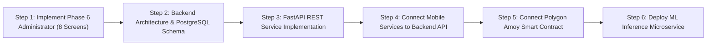

# TRUSTCHAIN — Complete Frontend Audit & Development Progress Report
**Document Version:** 1.0.0  
**Audit Date:** October 31, 2026  
**Auditor:** Principal Enterprise Architect, Mobile Systems Lead & Security Engineer  
**Project Workspace:** `/Users/reethika/Desktop/Trustchain`  
**Target Release:** Enterprise Supply Chain Resilience Platform (Multi-Tier Disruption Recovery & Governance)  

---

## 1. Executive Summary

### 1.1 Project Mission & High-Level Scope
TRUSTCHAIN is an enterprise mobile supply-chain resilience and decentralized governance platform designed for high-consequence logistics networks. The platform is engineered to detect real-time operational disruptions (e.g., maritime bottlenecks, port closures, severe weather, inventory stockouts), simulate multi-criteria recovery options using predictive intelligence, coordinate cross-role decision approval workflows, and enforce immutable accountability across organizational boundaries.

The architecture coordinates five distinct enterprise personas:
1. **Operations Analyst:** Identifies disruptions, analyzes order impact, runs recovery simulations, and formulates mitigation plans.
2. **Supply Chain Manager:** Evaluates high-level supply network health, reviews cross-enterprise recovery proposals, weighs financial/SLA trade-offs, and issues executive authorizations.
3. **Warehouse Operator:** Executes physical ground operations, conducts mobile barcode/QR receiving, files photographic damage quarantine reports, manages bin-level stock balances, and carries out stock transfer tasks.
4. **Procurement Approver:** Governs vendor emergency sourcing, enforces capital delegation limits (e.g., ₹25.0L statutory ceiling), executes head-to-head supplier capability comparisons, issues purchase orders (POs), and monitors supplier counterparty risk.
5. **Administrator:** Centralizes identity governance, role-based access control (RBAC), multi-facility/warehouse configurations, external enterprise integrations, risk policy parameters, and system health auditing.

---

### 1.2 Current Development State (Phases 1 to 5 Complete, Phase 6 Pending)
This forensic audit was conducted immediately following the completion of **Phase 5 (Procurement Approver)** and prior to the commencement of **Phase 6 (Administrator)** and full-stack backend/database development.

The frontend codebase currently exhibits the following structural status:
- **Total Route Files:** **91 files** in `src/app/` (comprising **73 interactive screen routes** and **18 layout navigators**).
- **Phases Implemented & Verified:**
  - **Phase 1 (Authentication & Onboarding):** 100% complete across 6 public screens, 5 role-specific login portals, and a central authenticated dashboard router.
  - **Phase 2 (Operations Analyst):** 100% complete across 14 dedicated screens and 16 modular UI components.
  - **Phase 3 (Supply Chain Manager):** 100% complete across 20 dedicated screens, 10 modular UI components, and precalculated interactive multi-tier geospatial routing.
  - **Phase 4 (Warehouse Operator):** 100% complete across 15 dedicated screens, 6 specialized components, native hardware camera barcode scanning, photo evidence capture, and an interactive floor map.
  - **Phase 5 (Procurement Approver):** 100% complete across 11 dedicated screens, 10 specialized components, financial delegation enforcement, and head-to-head supplier comparison matrices.
  - **Phase 6 (Administrator):** **0% dedicated screens implemented** (0 of 8 core admin screens exist in `src/app/(protected)/administrator/`; only the Phase 1 login portal and dashboard role card currently exist).

---

### 1.3 Key Architectural Findings & Operational Reality
1. **Frontend-Driven Local State Architecture:**  
   The application currently operates entirely on client-side in-memory singleton observable services (`operationsService`, `managerService`, `warehouseService`, `procurementService`, and `auth`). Each service manages state in memory arrays initialized from seeded mock data files. Component reactivity is achieved via subscriber patterns (`subscribe()`) coupled with React 19 external store versioning (`useSyncExternalStore` pattern).
2. **Session Persistence vs. Domain Data Volatility:**  
   Authentication sessions (access tokens, refresh tokens, user profile metadata) are durably persisted to native hardware via `expo-secure-store` (falling back to `localStorage` on web). However, **all domain mutations** (e.g., approved recovery plans, submitted damage reports, received goods, issued purchase orders, inventory counts) reside strictly in volatile JavaScript heap memory and reset whenever the application process restarts.
3. **External Integration Reality (Backend, ML, Blockchain):**  
   - **Backend API:** There are **zero live backend REST or WebSocket connections** in the mobile app. The mobile client does not currently communicate with any backend server (FastAPI at `backend/app/main.py` exists in the repository as a standalone prototype, but is unlinked).
   - **Machine Learning (AI):** Disruption risk scores, order delay predictions, and recovery plan simulation scores are hardcoded/precalculated in TypeScript mock datasets. The exploratory scikit-learn models in `disruption.ipynb` have not been converted into an active microservice or on-device model.
   - **Blockchain:** All blockchain transaction hashes (e.g., `0x8f2a17cb6e94ad31`) displayed on receipts, approval cards, and audit trails are client-side pseudo-random strings generated via `Math.random().toString(16)`. The Solidity governance contract (`TrustChainGovernance.sol` in `blockchain/contracts/`) is not connected to the React Native app; no Web3 RPC provider (`ethers.js` or `viem`) is installed in the mobile package.

---

### 1.4 Technical Health Metrics
Safe, non-destructive quality checks executed during this audit confirm high frontend source integrity:
- **TypeScript Compilation (`npx tsc --noEmit`):** **0 errors** (100% strictly typed).
- **Dependency & Config Health (`npx expo-doctor`):** **20/20 checks passed** (0 incompatibilities).
- **Static Code Analysis (`npx expo lint --quiet`):** **0 ESLint errors** (clean React 19 compliance).

---

## 2. Project Technology Stack

### 2.1 Core Runtime & Frameworks
| Layer | Technology | Version | Purpose in TRUSTCHAIN |
|---|---|---|---|
| **Platform Runtime** | Expo SDK | `~58.0.21` | Managed React Native development platform and native API bridge |
| **Mobile Framework** | React Native | `0.88.1` | Native cross-platform rendering engine for iOS and Android |
| **Core UI Library** | React | `19.3.0` | Declarative UI component model with modern concurrency support |
| **Routing / Navigation** | Expo Router | `~58.0.28` | File-system-based typed navigation engine built on React Navigation |
| **Language** | TypeScript | `^5.9.3` | Strict static typing across all routes, components, and data models |
| **Architecture Mode** | New Architecture | Enabled | Fabric native rendering and TurboModules enabled |

---

### 2.2 Device Hardware & Native Integrations
| Package | Version | Purpose & Implementation Details |
|---|---|---|
| `expo-camera` | `~58.0.14` | Native hardware barcode/QR scanning on Android (`BarcodeScanningResult`, back camera with torch toggle, target reticle) |
| `expo-image-picker` | `~58.0.10` | Native photo capture and gallery selection for damage report evidence (`launchCameraAsync`, `launchImageLibraryAsync`) |
| `expo-secure-store` | `~58.0.2` | Encrypted hardware keychain/Keystore storage for JWT access/refresh tokens (`setItemAsync`, `getItemAsync`) |
| `react-native-maps` | `1.29.11` | Interactive geospatial mapping with custom raster tile overlay (`https://a.basemaps.cartocdn.com/rastertiles/voyager/`) |
| `react-native-svg` | `15.16.0` | Vector rendering for risk donut charts, impact flow diagrams, and warehouse floor maps |
| `react-native-reanimated` | `4.7.1` | High-performance 60fps animations for bottom sheets, modal overlays, and step transitions |
| `react-native-safe-area-context` | `~5.10.1` | Precise notch, dynamic island, and Android gesture navigation bar inset handling |
| `lucide-react-native` | `^1.65.0` | Standardized enterprise iconography across all 5 role suites |

---

### 2.3 Build & Lint Configuration
- **TypeScript Configuration (`tsconfig.json`):**  
  Configured with `moduleResolution: "bundler"`, `strict: true`, path alias `@/*` mapped to `./src/*`, and explicit exclusion of `backend` and `blockchain` subdirectories.
- **ESLint Configuration (`eslint.config.js`):**  
  Configured with `expo/flat` lint rules. All React 19 render cycle violations (such as `set-state-in-effect`) have been resolved through external store synchronization.
- **Expo Configuration (`app.json`):**  
  Configured for package `com.trustchain.mobile`, orientation `portrait`, scheme `trustchain`, splash screen `#10234D`, and required camera permissions for physical barcode scanning.

---

## 3. Complete Project Structure

```
Trustchain/
├── app.json                                 # Expo project configuration and native permissions
├── package.json                             # Mobile application dependencies and scripts
├── tsconfig.json                            # TypeScript configuration with path aliases
├── eslint.config.js                         # Flat ESLint configuration for React 19 / Expo
├── disruption.ipynb                         # Exploratory scikit-learn ML notebook
├── TRUSTCHAIN_Basic_Framework/              # Legacy specifications and conceptual diagrams
├── backend/                                 # Standalone FastAPI prototype (unconnected)
│   ├── app/
│   │   ├── main.py                          # FastAPI entrypoint (/health, /blockchain)
│   │   └── blockchain/                      # Web3 Python service bindings
│   └── requirements.txt
├── blockchain/                              # Standalone Hardhat workspace (unconnected)
│   ├── contracts/
│   │   └── TrustChainGovernance.sol         # Solidity governance contract
│   ├── hardhat.config.js
│   └── package.json
├── assets/                                  # Static image assets, icons, and splash screens
└── src/                                     # Mobile Application Source Code
    ├── app/                                 # Expo Router File-Based Route Tree (91 files)
    │   ├── _layout.tsx                      # Root Application Layout & Auth Provider
    │   ├── index.tsx                        # Public Welcome / Landing Screen
    │   ├── (auth)/                          # Role-Specific Direct Login Portals
    │   │   ├── _layout.tsx                  # Auth Group Navigator
    │   │   ├── operations-analyst.tsx       # Analyst Login Portal
    │   │   ├── supply-chain-manager.tsx     # Manager Login Portal
    │   │   ├── warehouse-operator.tsx       # Warehouse Operator Login Portal
    │   │   ├── procurement-approver.tsx     # Procurement Approver Login Portal
    │   │   └── administrator.tsx            # Administrator Login Portal
    │   ├── (public)/                        # Public Onboarding & Recovery Flows
    │   │   ├── _layout.tsx                  # Public Stack Navigator
    │   │   ├── onboarding.tsx               # 3-Slide Interactive Product Onboarding
    │   │   ├── role-selection.tsx           # Role Exploration & Selection Grid
    │   │   ├── signin.tsx                   # Universal Email/Password Sign-In
    │   │   ├── signup.tsx                   # User Account Registration
    │   │   ├── forgot-password.tsx          # Password Reset Request & Token Entry
    │   │   └── choose-workspace.tsx         # Enterprise Tenant / Workspace Picker
    │   └── (protected)/                     # Authenticated Enterprise Experience
    │       ├── _layout.tsx                  # Protected Root Guard & Token Check
    │       ├── dashboard.tsx                # Central Gateway & Role Switcher
    │       ├── operations-analyst/          # Operations Analyst Suite (14 screens)
    │       │   ├── _layout.tsx
    │       │   ├── home.tsx                 # Real-Time Monitoring & Disruption Feed
    │       │   ├── orders.tsx               # High-Risk Affected Orders Directory
    │       │   ├── risk.tsx                 # Predictive Risk Intelligence & Donut
    │       │   ├── notifications.tsx        # Critical Alert Notifications
    │       │   ├── profile.tsx              # Analyst Profile & Session Controls
    │       │   ├── disruptions/
    │       │   │   ├── _layout.tsx
    │       │   │   ├── index.tsx            # Disruption Directory with Filters
    │       │   │   └── [id]/
    │       │   │       ├── index.tsx        # Disruption Details & Timeline
    │       │   │       └── impact.tsx       # Order Impact Flow Diagram & Summary
    │       │   └── recovery/
    │       │       ├── _layout.tsx
    │       │       ├── create.tsx           # Recovery Plan Formulation Wizard
    │       │       ├── actions.tsx          # Action Selection (Reroute, Air, Supplier)
    │       │       ├── simulation.tsx       # Multi-Criteria Simulation Results
    │       │       ├── recommendations.tsx  # AI Optimization Recommendations
    │       │       ├── review.tsx           # Plan Review & Submit for Approval
    │       │       └── execution.tsx        # In-Flight Mitigation Execution Tracker
    │       ├── supply-chain-manager/        # Supply Chain Manager Suite (20 screens)
    │       │   ├── _layout.tsx
    │       │   ├── home.tsx                 # Executive Command Dashboard
    │       │   ├── network.tsx              # Interactive Geo Map & Active Corridors
    │       │   ├── intelligence.tsx         # Disruption Intelligence & AI Feed
    │       │   ├── impact.tsx               # Financial & SLA Revenue Exposure
    │       │   ├── risk-analysis.tsx        # Multi-Tier Risk Matrix & Heatmap
    │       │   ├── analytics.tsx            # Supply Chain KPI & SLA Performance
    │       │   ├── audit.tsx                # Blockchain Governance Audit Trail
    │       │   ├── warehouses.tsx           # Facility Directory & Capacity Gauges
    │       │   ├── warehouse-supplier.tsx   # Warehouse-to-Supplier Topology
    │       │   ├── profile.tsx              # Executive Profile & Notification Settings
    │       │   ├── approvals/
    │       │   │   ├── _layout.tsx
    │       │   │   ├── index.tsx            # Pending Approval Requests Queue
    │       │   │   └── [id]/
    │       │   │       ├── index.tsx        # Recovery Plan Executive Deep-Dive
    │       │   │       └── decision.tsx     # Executive Sign-Off / Rejection Modal
    │       │   ├── disruptions/
    │       │   │   ├── _layout.tsx
    │       │   │   ├── index.tsx            # Manager Disruption Overview
    │       │   │   └── [id].tsx             # Strategic Disruption Incident Summary
    │       │   ├── suppliers/
    │       │   │   ├── _layout.tsx
    │       │   │   ├── index.tsx            # Strategic Vendor Directory
    │       │   │   ├── [id].tsx             # Vendor Scorecard & Disruption Risk
    │       │   │   └── compare.tsx          # Head-to-Head Alternative Supplier Matrix
    │       │   └── recovery/
    │       │       ├── _layout.tsx
    │       │       ├── index.tsx            # Active Recovery Operations List
    │       │       └── [id].tsx             # Recovery Operation Milestone Tracking
    │       ├── warehouse-operator/          # Warehouse Operator Suite (15 screens)
    │       │   ├── _layout.tsx
    │       │   ├── home.tsx                 # Shift Overview & Warehouse Metrics
    │       │   ├── scan.tsx                 # Barcode / QR Scanner (Camera & Manual)
    │       │   ├── receiving.tsx            # Goods Inward Inspection & Receipt
    │       │   ├── damage-report.tsx        # Photographic Damage Quarantine
    │       │   ├── inventory.tsx            # Real-Time Inventory & Stock Adjuster
    │       │   ├── stock-transfer.tsx       # Inter-Bin & Inter-Facility Transfer
    │       │   ├── warehouse-map.tsx        # Interactive SVG Facility Floor Map
    │       │   ├── incoming-shipments.tsx   # Dock Inbound Manifest Directory
    │       │   ├── outgoing-shipments.tsx   # Outbound Staging & Dispatch Queue
    │       │   ├── notifications.tsx        # Operational Shift Alerts
    │       │   ├── profile.tsx              # Operator Identity & Warehouse Station
    │       │   ├── tasks/
    │       │   │   ├── _layout.tsx
    │       │   │   ├── index.tsx            # Prioritized Operator Task List
    │       │   │   └── [id].tsx             # Interactive Step-by-Step Task Execution
    │       │   └── product/
    │       │       ├── _layout.tsx
    │       │       ├── index.tsx            # SKU Catalog & Barcode Lookup
    │       │       └── [sku].tsx            # Detailed Product Spec & Stock Allocation
    │       └── procurement-approver/        # Procurement Approver Suite (11 screens)
    │           ├── _layout.tsx
    │           ├── home.tsx                 # Procurement Home & Approval KPIs
    │           ├── risk-analysis.tsx        # 6-Dimension Supplier Risk Assessment
    │           ├── purchase-orders.tsx      # PO Directory & Cancellation Controls
    │           ├── approval-history.tsx     # Immutable Decision History & Hashes
    │           ├── notifications.tsx        # Priority Procurement Notifications
    │           ├── profile.tsx              # Approver Profile & Delegation Authority
    │           ├── requests/
    │           │   ├── _layout.tsx
    │           │   ├── index.tsx            # Sourcing Requests Filterable Queue
    │           │   └── [id].tsx             # Statutory Review & Decision Sheet
    │           └── suppliers/
    │               ├── _layout.tsx
    │               ├── index.tsx            # Approved Vendor Master List
    │               ├── [id].tsx             # Supplier Commercial Profile & KPIs
    │               └── compare.tsx          # 4-Tier Vendor Evaluation Matrix
    ├── components/                          # Core Shared Reusable UI Components (13 files)
    │   ├── BrandLogo.tsx                    # Official TRUSTCHAIN Vector Branding
    │   ├── ScreenContainer.tsx              # Keyboard-Aware Safe-Area Scroll Container
    │   ├── PrimaryButton.tsx                # Enterprise Solid Action Button
    │   ├── SecondaryButton.tsx              # Outlined Secondary Action Button
    │   ├── FormInput.tsx                    # Floating-Label Validated Input
    │   ├── RoleCard.tsx                     # Interactive Role Selection Card
    │   ├── RoleLoginTemplate.tsx            # Standardized Branded Auth Portal
    │   ├── OnboardingSlide.tsx              # Swipable Product Onboarding Card
    │   ├── IllustrationPanel.tsx            # SVG Technical Vector Graphics
    │   ├── external-link.tsx                # Cross-Platform Browser Link
    │   ├── themed-text.tsx                  # Design-Token Typography Component
    │   ├── themed-view.tsx                  # Theme-Aware Container View
    │   └── ui/collapsible.tsx               # Accessible Accordion Component
    ├── constants/                           # Global Design System & Tokens
    │   ├── colors.ts                        # Unified Palette (Navy, Blue, Green, Purple, Slate)
    │   ├── theme.ts                         # Insets, Font Families, Spacing Scales
    │   ├── typography.ts                    # Font Weights, Line Heights, Headings
    │   └── spacing.ts                       # 4px-Grid Layout Padding & Margins
    ├── features/                            # Domain-Driven Feature Modules (42 files)
    │   ├── operations-analyst/              # Components, Services, Types, Mocks
    │   ├── supply-chain-manager/            # Components, Services, Types, Mocks, GeoJSON
    │   ├── warehouse-operator/              # Components, Services, Types, Mocks
    │   └── procurement-approver/            # Components, Services, Types, Mocks
    ├── hooks/                               # Custom React Hooks
    │   ├── useAuth.tsx                      # Authentication Context & Session State
    │   ├── use-theme.ts                     # Light/Dark Theme Context Accessor
    │   ├── use-color-scheme.ts              # Native Appearance Hook
    │   └── use-color-scheme.web.ts          # Web-Safe Appearance Hook
    ├── services/                            # Cross-Cutting Core Services
    │   ├── auth.ts                          # JWT Session Management & Seeded Users
    │   └── validation.ts                    # RFC-Compliant Form Validation
    └── types/                               # System-Wide TypeScript Interfaces
        ├── auth.ts                          # User, Session, Token, Credential Models
        ├── roles.ts                         # Role Constants, Permissions, Routes
        └── declarations.d.ts                # SVG and Asset Type Declarations
```

---

## 4. All Five User Roles: Comprehensive Analysis

### 4.1 Role 1: Operations Analyst
- **Primary Persona & Mandate:** Frontline operational monitor responsible for continuous surveillance of inbound corridors, maritime logistics, supplier delays, and inventory shortfalls. Formulates mitigation strategies and coordinates with downstream managers.
- **Implemented Routes (14 screens):**
  1. `/operations-analyst/home`: Operational KPI cards (Active Disruptions, Critical Risk, Orders At Risk, Revenue Exposure), Singapore port disruption spotlight, quick actions.
  2. `/operations-analyst/disruptions/index`: Full filterable directory of active disruption incidents with severity filters (Critical, High, Medium, Low).
  3. `/operations-analyst/disruptions/[id]/index`: In-depth incident chronology, affected SKUs, root-cause diagnostics, and linked carrier references.
  4. `/operations-analyst/disruptions/[id]/impact`: Interactive visual impact flow diagram mapping Disruption -> Inbound Shipment -> Buffer Shortfall -> Customer Orders.
  5. `/operations-analyst/orders`: Master directory of all customer orders jeopardized by supply delays, sorting by revenue and delivery commitment.
  6. `/operations-analyst/risk`: Real-time predictive risk dashboard featuring an interactive SVG Risk Donut Chart and multi-factor threat scores.
  7. `/operations-analyst/recovery/create`: Mitigation planning wizard to title plans, set target recovery windows, and configure budget limits.
  8. `/operations-analyst/recovery/actions`: Action configuration screen enabling analysts to select from 4 action archetypes (Air Expedite, Stock Transfer, Alt Sourcing, Split Fulfilment).
  9. `/operations-analyst/recovery/simulation`: Multi-criteria simulation engine comparing Baseline vs. Mitigated scenarios across Cost, Time, and SLA Restitution.
  10. `/operations-analyst/recovery/recommendations`: AI-generated mitigation rankings with algorithmic confidence scores and trade-off summaries.
  11. `/operations-analyst/recovery/review`: Consolidated plan review screen to verify operational steps and submit to Supply Chain Managers.
  12. `/operations-analyst/recovery/execution`: Live execution milestone tracker monitoring in-flight mitigation actions post-approval.
  13. `/operations-analyst/notifications`: Real-time operational incident feed with unread indicators and quick navigation links.
  14. `/operations-analyst/profile`: User account details, assigned permissions, and secure sign-out.
- **Data Source & Flow:** Backed by `operationsService.ts` and initialized from `mockData.ts`. Simulates updates to `RECOVERY_PLANS` and emits subscriber events.

---

### 4.2 Role 2: Supply Chain Manager
- **Primary Persona & Mandate:** Executive decision-maker overseeing enterprise-wide supply continuity, inter-facility balances, supplier performance scorecards, and high-value recovery authorizations.
- **Implemented Routes (20 screens):**
  1. `/supply-chain-manager/home`: Executive command center with high-level KPI tiles, urgent approval alerts, and network status overview.
  2. `/supply-chain-manager/approvals/index`: Filterable queue of recovery plans submitted by Operations Analysts awaiting executive decision.
  3. `/supply-chain-manager/approvals/[id]/index`: Comprehensive review of proposed recovery plan, SLA impact, financial cost, and risk reduction.
  4. `/supply-chain-manager/approvals/[id]/decision`: Executive sign-off modal requiring explicit approval or mandatory rejection reasoning with audit logging.
  5. `/supply-chain-manager/network`: Geospatial network corridor map displaying transit routes, active shipments, and node status via `react-native-maps`.
  6. `/supply-chain-manager/intelligence`: Disruption intelligence feed aggregating geopolitical, maritime, and carrier threat telemetry.
  7. `/supply-chain-manager/impact`: Financial exposure dashboard quantifying total revenue at risk, customer penalties, and buffer depletion.
  8. `/supply-chain-manager/risk-analysis`: Multi-dimensional risk matrix categorizing network vulnerabilities by tier and geographic corridor.
  9. `/supply-chain-manager/analytics`: Longitudinal KPI performance reporting measuring On-Time In-Full (OTIF), recovery velocity, and carrier adherence.
  10. `/supply-chain-manager/audit`: Blockchain-style immutable governance log displaying decision actor, timestamp, action, and transaction hash.
  11. `/supply-chain-manager/warehouses`: Directory of regional fulfillment centers with capacity utilization bars and inventory health badges.
  12. `/supply-chain-manager/warehouse-supplier`: Interactive topological map correlating suppliers to regional receiving warehouses.
  13. `/supply-chain-manager/suppliers/index`: Master vendor directory tracking reliability scores, disruption history, and active purchase volume.
  14. `/supply-chain-manager/suppliers/[id]`: Vendor scorecard profiling delivery lead time, quality ratings, and open recovery commitments.
  15. `/supply-chain-manager/suppliers/compare`: Head-to-head comparison tool evaluating alternative suppliers on cost, lead time, and capacity.
  16. `/supply-chain-manager/disruptions/index`: Strategic overview of global network disruptions with aggregated impact statistics.
  17. `/supply-chain-manager/disruptions/[id]`: High-level disruption briefing summarizing executive escalation status and mitigation budget.
  18. `/supply-chain-manager/recovery/index`: Directory of all active, approved, and completed recovery operations across the enterprise.
  19. `/supply-chain-manager/recovery/[id]`: Detailed milestone progress tracker for approved recovery initiatives.
  20. `/supply-chain-manager/profile`: Executive profile, organization identity, notification preferences, and session termination.
- **Data Source & Flow:** Backed by `managerService.ts` and `precalculatedRoutes.json`. When a manager approves a plan, `managerService.makeApprovalDecision` updates the shared plan status and writes an audit event to the internal audit log.

---

### 4.3 Role 3: Warehouse Operator
- **Primary Persona & Mandate:** Ground-level logistics specialist managing inbound receiving docks, pallet verification, physical inventory adjustments, quarantine of damaged freight, and warehouse floor transfers.
- **Implemented Routes (15 screens):**
  1. `/warehouse-operator/home`: Shift briefing dashboard displaying pending tasks, receipts processed, quarantine holds, and quick action shortcuts.
  2. `/warehouse-operator/tasks/index`: Prioritized shift task list categorized by task type (Pick/Pack, Receive, Stock Transfer, Inspection).
  3. `/warehouse-operator/tasks/[id]`: Step-by-step interactive task execution checklist with step completion toggles and final task submission.
  4. `/warehouse-operator/scan`: Multi-modal barcode/QR scanning interface using native `expo-camera` with manual SKU entry fallback.
  5. `/warehouse-operator/product/index`: Real-time warehouse catalog with SKU search, barcode cross-referencing, and bin location index.
  6. `/warehouse-operator/product/[sku]`: Comprehensive product card displaying total on-hand, allocated, and quarantined quantities with bin storage address.
  7. `/warehouse-operator/receiving`: Inbound dock receiving screen to verify carrier manifests, validate quantities, and generate formal Goods Receipt records.
  8. `/warehouse-operator/damage-report`: Photographic damage quarantine reporting flow with `expo-image-picker` camera/gallery integration and damage reason classification.
  9. `/warehouse-operator/inventory`: Master stock balance controller with real-time increment/decrement steppers and audit reason tracking.
  10. `/warehouse-operator/stock-transfer`: Internal stock relocation interface moving inventory between warehouse zones (Aisle/Rack/Shelf/Bin) with transfer verification.
  11. `/warehouse-operator/incoming-shipments`: Inbound delivery manifest monitor tracking carrier arrival times and dock assignment.
  12. `/warehouse-operator/outgoing-shipments`: Outbound staging monitor showing picked and packed consignments queued for carrier dispatch.
  13. `/warehouse-operator/warehouse-map`: Interactive SVG warehouse facility map rendering aisles, cold storage, receiving docks, and quarantine zones.
  14. `/warehouse-operator/notifications`: Real-time operational alerts regarding incoming hot freight, quarantine orders, and dock assignments.
  15. `/warehouse-operator/profile`: Operator credentials, assigned warehouse station (e.g., WH-BOM-01), shift details, and secure logout.
- **Data Source & Flow:** Backed by `warehouseService.ts` initialized from `warehouseMockData.ts`. Recording goods receipts or stock transfers mutates in-memory inventory balances and generates simulated blockchain transaction hashes (`0x...`).

---

### 4.4 Role 4: Procurement Approver
- **Primary Persona & Mandate:** Commercial gatekeeper and purchasing authority tasked with reviewing emergency sourcing requisitions, validating vendor compliance, enforcing budget delegation thresholds, and issuing binding Purchase Orders.
- **Implemented Routes (11 screens):**
  1. `/procurement-approver/home`: Procurement dashboard tracking Pending Requests, Today's Approvals, Active Suppliers, and Counterparty Risk Alerts.
  2. `/procurement-approver/requests/index`: Filterable requisition queue sorted by status (Pending, Approved, Rejected) and urgency priority.
  3. `/procurement-approver/requests/[id]`: High-stakes approval decision screen featuring statutory financial delegation verification (₹25.0L threshold enforcement), business justifications, and bottom action sheet.
  4. `/procurement-approver/suppliers/index`: Comprehensive supplier directory displaying vendor qualification ratings, category, and risk scores.
  5. `/procurement-approver/suppliers/[id]`: Detailed supplier commercial profile outlining On-Time Delivery (OTD), Quality scores, ESG compliance, and bank account status.
  6. `/procurement-approver/suppliers/compare`: 4-column side-by-side vendor comparison matrix evaluating Unit Price, MOQ, Lead Time, and Reliability.
  7. `/procurement-approver/purchase-orders`: Enterprise purchase order directory tracking status (Open, In Production, Dispatched) with cancellation authority.
  8. `/procurement-approver/risk-analysis`: 6-dimension vendor risk radar evaluating Geopolitical, Financial, Operational, Regulatory, ESG, and Cybersecurity exposures.
  9. `/procurement-approver/approval-history`: Immutable decision ledger displaying approver identity, timestamp, decision rationale, and cryptographic transaction receipt.
  10. `/procurement-approver/notifications`: High-priority procurement alerts regarding threshold breaches, vendor status downgrades, and urgent requisitions.
  11. `/procurement-approver/profile`: Approver profile, commercial delegation ceiling, active procurement authorization level, and session sign-out.
- **Data Source & Flow:** Backed by `procurementService.ts` initialized from `procurementMockData.ts`. When an approver grants approval, `procurementService.approveRequest` verifies that the amount does not exceed the approver's delegation threshold (₹25,00,000), transitions request status to `approved`, creates a corresponding Purchase Order (`PO-2026-XXXX`), writes to the approval history, and notifies subscribers.

---

### 4.5 Role 5: Administrator
- **Primary Persona & Mandate:** Platform governance, identity lifecycle management, multi-organization tenant setup, system health monitoring, external integration configuration, and global risk policy administration.
- **Implemented Routes (0 dedicated screens):**
  - Dedicated screens in `src/app/(protected)/administrator/*`: **0 screens** (Unimplemented).
  - Implemented Route Entrypoints:
    1. `src/app/(auth)/administrator.tsx`: Dedicated role login portal.
    2. `src/app/(protected)/dashboard.tsx`: Displays Administrator profile card and quick switch links.
- **Current Operational Reality:**  
  While the Administrator user account (`admin@trustchain.io`) is seeded in `MOCK_USERS_DB` and can authenticate successfully, signing in redirects to `/(protected)/dashboard`. There are currently no administrative screens to manage users, configure permissions, add warehouses, monitor server health, or inspect platform-wide audit logs. **All 8 Phase 6 screens remain to be developed.**

---

## 5. Complete Screen Inventory

The following table documents every interactive screen file currently present in `src/app/` (excluding layout navigators).

| # | Screen Name | Role / Category | File Path | Main Purpose | UI Components | User Actions | Data Source | Status | Backend Requirement |
|---|---|---|---|---|---|---|---|---|---|
| 1 | Landing Screen | Public / Entry | `src/app/index.tsx` | Platform introduction & entrypoint | BrandLogo, Hero Cards, CTA Buttons | Navigate to Sign In, Explore Roles | Static / Theme | Complete | None (Static Client) |
| 2 | Product Onboarding | Public / Auth | `src/app/(public)/onboarding.tsx` | 3-step value proposition carousel | OnboardingSlide, Pager Dots, CTA Button | Swipe slides, Skip, Get Started | Static Content | Complete | Track user onboarding state |
| 3 | Role Selection | Public / Auth | `src/app/(public)/role-selection.tsx` | Interactive role exploration grid | RoleCard, Badges, Category Chips | Select role, Navigate to role login | `ROLES` constant | Complete | Dynamic role definitions |
| 4 | Universal Sign In | Public / Auth | `src/app/(public)/signin.tsx` | Secure account authentication | FormInput, PrimaryButton, Error Banner | Enter credentials, Submit login, Remember me | `authService` | Complete | `POST /api/v1/auth/login` |
| 5 | User Registration | Public / Auth | `src/app/(public)/signup.tsx` | New account onboarding request | FormInput, Dropdowns, CTA Button | Submit registration, Request role | `authService` | Complete | `POST /api/v1/auth/register` |
| 6 | Forgot Password | Public / Auth | `src/app/(public)/forgot-password.tsx` | Password reset flow | FormInput, Step Wizard, Action Buttons | Submit email, Verify code, Reset password | `authService` | Complete | `POST /api/v1/auth/reset-password` |
| 7 | Choose Workspace | Public / Auth | `src/app/(public)/choose-workspace.tsx` | Multi-tenant organization picker | Org Cards, Search Input, Radio Buttons | Select enterprise tenant workspace | Static Mock Orgs | Complete | `GET /api/v1/user/workspaces` |
| 8 | Analyst Login | Role Login | `src/app/(auth)/operations-analyst.tsx` | Direct login portal for Analysts | RoleLoginTemplate, Quick Fill Pills | Authenticate as Operations Analyst | `authService` | Complete | `POST /api/v1/auth/login` |
| 9 | Manager Login | Role Login | `src/app/(auth)/supply-chain-manager.tsx` | Direct login portal for Managers | RoleLoginTemplate, Quick Fill Pills | Authenticate as Supply Chain Manager | `authService` | Complete | `POST /api/v1/auth/login` |
| 10 | Operator Login | Role Login | `src/app/(auth)/warehouse-operator.tsx` | Direct login portal for Operators | RoleLoginTemplate, Quick Fill Pills | Authenticate as Warehouse Operator | `authService` | Complete | `POST /api/v1/auth/login` |
| 11 | Approver Login | Role Login | `src/app/(auth)/procurement-approver.tsx` | Direct login portal for Approvers | RoleLoginTemplate, Quick Fill Pills | Authenticate as Procurement Approver | `authService` | Complete | `POST /api/v1/auth/login` |
| 12 | Admin Login | Role Login | `src/app/(auth)/administrator.tsx` | Direct login portal for Admins | RoleLoginTemplate, Quick Fill Pills | Authenticate as Administrator | `authService` | Complete | `POST /api/v1/auth/login` |
| 13 | Role Gateway | Protected Core | `src/app/(protected)/dashboard.tsx` | Authenticated role switcher | User Banner, Role Cards, Fast Switches | Switch active persona, Logout | `useAuth`, `ROLES` | Complete | `POST /api/v1/auth/switch-role` |
| 14 | Analyst Home | Operations Analyst | `src/app/(protected)/operations-analyst/home.tsx` | Operational surveillance dashboard | OperationsHeader, MetricCard, DisruptionCard | View metrics, Search incidents, Navigate | `operationsService` | Complete | `GET /api/v1/analyst/dashboard` |
| 15 | Disruptions Directory | Operations Analyst | `src/app/(protected)/operations-analyst/disruptions/index.tsx` | Filterable incident feed | SearchBar, FilterChips, DisruptionCard | Search, Filter by severity, Open detail | `operationsService` | Complete | `GET /api/v1/disruptions` |
| 16 | Disruption Details | Operations Analyst | `src/app/(protected)/operations-analyst/disruptions/[id]/index.tsx` | In-depth incident chronology | TimelineView, StatusBadge, Metric Cards | Review timeline, Open impact analysis | `operationsService` | Complete | `GET /api/v1/disruptions/{id}` |
| 17 | Impact Analysis | Operations Analyst | `src/app/(protected)/operations-analyst/disruptions/[id]/impact.tsx` | Root-cause supply chain mapping | ImpactFlowDiagram, OrderCard, Metrics | Inspect order impacts, Start recovery | `operationsService` | Complete | `GET /api/v1/disruptions/{id}/impact` |
| 18 | Affected Orders | Operations Analyst | `src/app/(protected)/operations-analyst/orders.tsx` | Jeopardized customer orders | SearchBar, OrderCard, Revenue Badges | Search orders, Filter by risk level | `operationsService` | Complete | `GET /api/v1/orders/at-risk` |
| 19 | Predictive Risk | Operations Analyst | `src/app/(protected)/operations-analyst/risk.tsx` | Multi-factor risk analysis | RiskDonutChart, Category Metric Cards | Inspect risk dimensions, View alerts | `operationsService` | Complete | `GET /api/v1/intelligence/risk` |
| 20 | Create Recovery Plan | Operations Analyst | `src/app/(protected)/operations-analyst/recovery/create.tsx` | Mitigation formulation wizard | FormInput, Dropdowns, Date Pickers | Input plan title, Set recovery targets | `operationsService` | Complete | `POST /api/v1/recovery-plans` |
| 21 | Add Recovery Actions | Operations Analyst | `src/app/(protected)/operations-analyst/recovery/actions.tsx` | Mitigation action selector | ActionCard, Stepper Counter, Checkboxes | Configure air expedite, reroute, sourcing | `operationsService` | Complete | `POST /api/v1/recovery-plans/actions` |
| 22 | Simulation Results | Operations Analyst | `src/app/(protected)/operations-analyst/recovery/simulation.tsx` | Multi-criteria simulation comparison | Comparison Table, Bar Charts, KPI Gauges | Compare baseline vs mitigation, Select plan | `operationsService` | Complete | `POST /api/v1/simulation/run` |
| 23 | AI Recommendations | Operations Analyst | `src/app/(protected)/operations-analyst/recovery/recommendations.tsx` | Algorithmic plan recommendations | Recommendation Cards, Confidence Pills | Accept AI recommendation, Edit plan | `operationsService` | Complete | `GET /api/v1/ai/recommendations` |
| 24 | Plan Review & Submit | Operations Analyst | `src/app/(protected)/operations-analyst/recovery/review.tsx` | Plan verification before submission | Summary Cards, Cost Tally, Submit Button | Review all actions, Submit for approval | `operationsService` | Complete | `POST /api/v1/recovery-plans/{id}/submit` |
| 25 | Execution Tracking | Operations Analyst | `src/app/(protected)/operations-analyst/recovery/execution.tsx` | Live mitigation execution monitor | Progress Bars, Step Checklists, Status | Monitor action execution, Mark done | `operationsService` | Complete | `GET /api/v1/recovery-plans/{id}/tracking` |
| 26 | Analyst Notifications | Operations Analyst | `src/app/(protected)/operations-analyst/notifications.tsx` | Real-time incident notifications | Notification Tiles, Badge Counters | Filter by unread, Mark read, Navigate | `operationsService` | Complete | `GET /api/v1/notifications` |
| 27 | Analyst Profile | Operations Analyst | `src/app/(protected)/operations-analyst/profile.tsx` | User profile & session management | User Card, Permission List, Sign Out | View profile, Change theme, Sign out | `useAuth` | Complete | `GET /api/v1/user/profile` |
| 28 | Manager Home | Supply Chain Manager | `src/app/(protected)/supply-chain-manager/home.tsx` | Executive command dashboard | ManagerHeader, ManagerMetricCard, Approvals | Review KPIs, Navigate to approvals/network | `managerService` | Complete | `GET /api/v1/manager/dashboard` |
| 29 | Pending Approvals | Supply Chain Manager | `src/app/(protected)/supply-chain-manager/approvals/index.tsx` | Executive approval queue | ApprovalCard, Filter Tabs, Priority Badges | Filter plans, Open plan decision | `managerService` | Complete | `GET /api/v1/approvals/pending` |
| 30 | Plan Approval Detail | Supply Chain Manager | `src/app/(protected)/supply-chain-manager/approvals/[id]/index.tsx` | Executive recovery evaluation | SLA Metrics, Financial Cost, Actions List | Review details, Open decision modal | `managerService` | Complete | `GET /api/v1/approvals/{id}` |
| 31 | Approval Decision | Supply Chain Manager | `src/app/(protected)/supply-chain-manager/approvals/[id]/decision.tsx` | Formal approval/rejection modal | TextInput (Mandatory Reject Reason), Buttons | Authorize plan, Reject with reason | `managerService` | Complete | `POST /api/v1/approvals/{id}/decision` |
| 32 | Geospatial Network | Supply Chain Manager | `src/app/(protected)/supply-chain-manager/network.tsx` | Real-time supply corridor map | NetworkMap, Node Callouts, RouteDetailSheet | Pan/zoom map, Inspect nodes, View routes | `managerService`, GeoJSON | Complete | `GET /api/v1/network/topology` |
| 33 | Threat Intelligence | Supply Chain Manager | `src/app/(protected)/supply-chain-manager/intelligence.tsx` | Geopolitical & climate threat feed | Feed Cards, Severity Badges, Filter Chips | Read threat alerts, View corridor risks | `managerService` | Complete | `GET /api/v1/intelligence/threats` |
| 34 | Financial Impact | Supply Chain Manager | `src/app/(protected)/supply-chain-manager/impact.tsx` | Revenue & SLA risk exposure | Exposure Gauges, Cost Tally, Charts | Inspect revenue risk, Filter customers | `managerService` | Complete | `GET /api/v1/manager/financial-impact` |
| 35 | Manager Risk Matrix | Supply Chain Manager | `src/app/(protected)/supply-chain-manager/risk-analysis.tsx` | Multi-tier supply risk analysis | Risk Heatmap, Corridor Scores, Badges | Inspect regional risk, Filter tiers | `managerService` | Complete | `GET /api/v1/manager/risk-analysis` |
| 36 | Analytics & SLAs | Supply Chain Manager | `src/app/(protected)/supply-chain-manager/analytics.tsx` | Supply chain KPI metrics & OTIF | Line/Bar Charts, Metric Cards, Date Filters | View OTIF trends, Carrier rankings | `managerService` | Complete | `GET /api/v1/analytics/kpis` |
| 37 | Blockchain Audit Log | Supply Chain Manager | `src/app/(protected)/supply-chain-manager/audit.tsx` | Immutable platform governance trail | AuditEventCard, Search, Hash Badges | Filter events, Verify transaction hash | `managerService` | Complete | `GET /api/v1/governance/audit-trail` |
| 38 | Warehouse Directory | Supply Chain Manager | `src/app/(protected)/supply-chain-manager/warehouses.tsx` | Regional distribution facilities | WarehouseCard, Utilization Bar, Badges | View capacity, Inspect health status | `managerService` | Complete | `GET /api/v1/facilities/warehouses` |
| 39 | Warehouse-Supplier | Supply Chain Manager | `src/app/(protected)/supply-chain-manager/warehouse-supplier.tsx` | Facility-to-vendor supply topology | Correlation Cards, Transit Links, Badges | Inspect inbound links, Filter regions | `managerService` | Complete | `GET /api/v1/network/facility-links` |
| 40 | Manager Suppliers | Supply Chain Manager | `src/app/(protected)/supply-chain-manager/suppliers/index.tsx` | Strategic vendor master list | SupplierCard, Search, Risk Badges | Search suppliers, Open scorecard | `managerService` | Complete | `GET /api/v1/suppliers` |
| 41 | Supplier Scorecard | Supply Chain Manager | `src/app/(protected)/supply-chain-manager/suppliers/[id].tsx` | Detailed supplier performance | OTD Gauge, Quality Score, Contact Card | Review metrics, Compare alternative | `managerService` | Complete | `GET /api/v1/suppliers/{id}` |
| 42 | Compare Suppliers | Supply Chain Manager | `src/app/(protected)/supply-chain-manager/suppliers/compare.tsx` | Alternative vendor evaluation | Comparison Table, Capability Checkmarks | Compare pricing, Lead time, Capacity | `managerService` | Complete | `POST /api/v1/suppliers/compare` |
| 43 | Strategic Disruptions | Supply Chain Manager | `src/app/(protected)/supply-chain-manager/disruptions/index.tsx` | Global operational disruption overview | Disruption Cards, KPI Ticker, Filters | Inspect major incidents, Review status | `managerService` | Complete | `GET /api/v1/disruptions/strategic` |
| 44 | Disruption Incident | Supply Chain Manager | `src/app/(protected)/supply-chain-manager/disruptions/[id].tsx` | Executive incident briefing | Cost Exposure, Action Summary, Timeline | Review executive brief, Track mitigation | `managerService` | Complete | `GET /api/v1/disruptions/{id}/brief` |
| 45 | Recovery Operations | Supply Chain Manager | `src/app/(protected)/supply-chain-manager/recovery/index.tsx` | Active mitigation initiatives | RecoveryPlanCard, Progress Bars | Monitor active plans, Filter status | `managerService` | Complete | `GET /api/v1/recovery-plans/active` |
| 46 | Recovery Milestone | Supply Chain Manager | `src/app/(protected)/supply-chain-manager/recovery/[id].tsx` | Detailed milestone progress | Milestone Timeline, Action Cards | Track operational execution | `managerService` | Complete | `GET /api/v1/recovery-plans/{id}` |
| 47 | Manager Profile | Supply Chain Manager | `src/app/(protected)/supply-chain-manager/profile.tsx` | Executive identity & settings | Profile Card, Preferences, Sign Out | View profile, Configure alerts, Logout | `useAuth` | Complete | `GET /api/v1/user/profile` |
| 48 | Operator Home | Warehouse Operator | `src/app/(protected)/warehouse-operator/home.tsx` | Warehouse shift briefing | WarehouseHeader, Metric Cards, Shortcuts | View shift stats, Launch camera scanner | `warehouseService` | Complete | `GET /api/v1/warehouse/shift-summary` |
| 49 | Operator Tasks | Warehouse Operator | `src/app/(protected)/warehouse-operator/tasks/index.tsx` | Prioritized operational tasks | Task Cards, Category Tabs, Priority Chips | Filter tasks, Start task execution | `warehouseService` | Complete | `GET /api/v1/warehouse/tasks` |
| 50 | Task Execution | Warehouse Operator | `src/app/(protected)/warehouse-operator/tasks/[id].tsx` | Step-by-step task checklist | Checklist Tiles, QuantityStepper, Submit | Toggle steps, Adjust count, Complete | `warehouseService` | Complete | `POST /api/v1/warehouse/tasks/{id}/complete` |
| 51 | Barcode / QR Scan | Warehouse Operator | `src/app/(protected)/warehouse-operator/scan.tsx` | Native camera barcode scanner | CameraView, Reticle, Flash Toggle, Manual Input | Scan physical barcode, Search SKU | `warehouseService`, Camera | Complete | `GET /api/v1/products/barcode/{code}` |
| 52 | Product Catalog | Warehouse Operator | `src/app/(protected)/warehouse-operator/product/index.tsx` | Warehouse inventory catalog | SearchBar, Product Cards, Bin Tags | Search products, Open SKU details | `warehouseService` | Complete | `GET /api/v1/warehouse/products` |
| 53 | Product Details | Warehouse Operator | `src/app/(protected)/warehouse-operator/product/[sku].tsx` | Comprehensive SKU specification | Stock Breakdown, Bin Address, Barcode | View on-hand/quarantine, Transfer stock | `warehouseService` | Complete | `GET /api/v1/warehouse/products/{sku}` |
| 54 | Goods Receiving | Warehouse Operator | `src/app/(protected)/warehouse-operator/receiving.tsx` | Inbound freight inspection | Manifest Form, QuantityStepper, Confirm | Validate count, Sign off receipt, Hash | `warehouseService` | Complete | `POST /api/v1/warehouse/receipts` |
| 55 | Damage Quarantine | Warehouse Operator | `src/app/(protected)/warehouse-operator/damage-report.tsx` | Photographic damage reporting | PhotoEvidencePicker, FormInput, Submit | Take photo, Select reason, Quarantine | `warehouseService`, ImagePicker | Complete | `POST /api/v1/warehouse/damage-reports` |
| 56 | Stock Inventory | Warehouse Operator | `src/app/(protected)/warehouse-operator/inventory.tsx` | Bin-level stock manager | SearchBar, QuantityStepper, Status Badges | Adjust quantities, Audit stock count | `warehouseService` | Complete | `PUT /api/v1/warehouse/inventory` |
| 57 | Stock Transfer | Warehouse Operator | `src/app/(protected)/warehouse-operator/stock-transfer.tsx` | Inter-bin / inter-warehouse moves | Location Pickers, QuantityStepper, Submit | Relocate stock, Generate transfer receipt | `warehouseService` | Complete | `POST /api/v1/warehouse/transfers` |
| 58 | Inbound Manifests | Warehouse Operator | `src/app/(protected)/warehouse-operator/incoming-shipments.tsx` | Dock arrival schedule | Shipment Cards, Carrier Badges, ETA | Monitor dock arrivals, Start receiving | `warehouseService` | Complete | `GET /api/v1/warehouse/shipments/inbound` |
| 59 | Outbound Staging | Warehouse Operator | `src/app/(protected)/warehouse-operator/outgoing-shipments.tsx` | Dispatch staging queue | Consignment Cards, Status Chips, Route | Review dispatch queue, Mark staged | `warehouseService` | Complete | `GET /api/v1/warehouse/shipments/outbound` |
| 60 | Warehouse Floor Map | Warehouse Operator | `src/app/(protected)/warehouse-operator/warehouse-map.tsx` | Interactive SVG facility map | WarehouseFloorMap, Zone Callouts, Legend | Tap zones (Aisle, Cold, Quarantine) | `warehouseService` | Complete | `GET /api/v1/warehouse/facility-map` |
| 61 | Operator Alerts | Warehouse Operator | `src/app/(protected)/warehouse-operator/notifications.tsx` | Dock & shift alert notifications | Notification Tiles, Unread Badges | Filter alerts, Mark read | `warehouseService` | Complete | `GET /api/v1/notifications` |
| 62 | Operator Profile | Warehouse Operator | `src/app/(protected)/warehouse-operator/profile.tsx` | Operator badge & station settings | Station Card, Permissions, Sign Out | View station assignment, Sign out | `useAuth`, `authService` | Complete | `GET /api/v1/user/profile` |
| 63 | Procurement Home | Procurement Approver | `src/app/(protected)/procurement-approver/home.tsx` | Commercial procurement dashboard | ProcurementHeader, Metric Cards, PO Feed | View approval KPIs, Launch compare | `procurementService` | Complete | `GET /api/v1/procurement/dashboard` |
| 64 | Sourcing Requests | Procurement Approver | `src/app/(protected)/procurement-approver/requests/index.tsx` | Sourcing requisitions queue | ProcurementRequestCard, Search, Tabs | Filter by Pending/Approved, Open review | `procurementService` | Complete | `GET /api/v1/procurement/requests` |
| 65 | Request Review | Procurement Approver | `src/app/(protected)/procurement-approver/requests/[id].tsx` | Statutory review & decision sheet | ApprovalDecisionSheet, Justification Card | Authorize within ₹25L, Reject with reason | `procurementService` | Complete | `POST /api/v1/procurement/requests/{id}/decision` |
| 66 | Vendor Directory | Procurement Approver | `src/app/(protected)/procurement-approver/suppliers/index.tsx` | Master vendor catalog | SupplierCard, Qualification Badges | Search vendors, Open commercial profile | `procurementService` | Complete | `GET /api/v1/suppliers` |
| 67 | Vendor Profile | Procurement Approver | `src/app/(protected)/procurement-approver/suppliers/[id].tsx` | Commercial & risk supplier scorecard | Score Gauges, Product Catalog, Bank Info | Review compliance, Initiate compare | `procurementService` | Complete | `GET /api/v1/suppliers/{id}` |
| 68 | Supplier Comparison | Procurement Approver | `src/app/(protected)/procurement-approver/suppliers/compare.tsx` | 4-tier commercial evaluation matrix | Comparison Table, Price/Lead Gauges | Compare vendors, Select awardee | `procurementService` | Complete | `POST /api/v1/procurement/compare` |
| 69 | Purchase Orders | Procurement Approver | `src/app/(protected)/procurement-approver/purchase-orders.tsx` | Commercial PO management | PurchaseOrderCard, Status Filter, Cancel Modal | Track PO progress, Cancel open orders | `procurementService` | Complete | `GET /api/v1/procurement/purchase-orders` |
| 70 | Supplier Risk Radar | Procurement Approver | `src/app/(protected)/procurement-approver/risk-analysis.tsx` | 6-dimension counterparty risk | Risk Metric Cards, Category Breakdown | Inspect ESG, Cyber, Geopolitical risk | `procurementService` | Complete | `GET /api/v1/procurement/risk-radar` |
| 71 | Approval History | Procurement Approver | `src/app/(protected)/procurement-approver/approval-history.tsx` | Cryptographic decision audit trail | Audit Timeline, TxHash Badges, Filter | Verify historical decisions and receipts | `procurementService` | Complete | `GET /api/v1/procurement/history` |
| 72 | Procurement Alerts | Procurement Approver | `src/app/(protected)/procurement-approver/notifications.tsx` | High-priority commercial alerts | Notification Tiles, Unread Indicators | Filter alerts, Mark read | `procurementService` | Complete | `GET /api/v1/notifications` |
| 73 | Approver Profile | Procurement Approver | `src/app/(protected)/procurement-approver/profile.tsx` | Financial delegation & profile | Delegation Authority Badge, Sign Out | View ₹25L limit, Terminate session | `useAuth` | Complete | `GET /api/v1/user/profile` |

---

## 6. Screen-by-Screen Feature Analysis

### 6.1 Authentication & Onboarding Flow
- **Universal Sign-In & Role Portals:** Supports credential-based authentication using seeded accounts in `src/services/auth.ts`. Each role has a specialized branded portal (`src/app/(auth)/*.tsx`) providing rapid-login pills for instant demo access.
- **Form Validation:** All text inputs are verified against RFC 5322 email patterns, minimum 8-character password complexity, and required organizational domain checks via `src/services/validation.ts`.
- **Session Tokens:** Successfully stores simulated JWT access and refresh tokens in `expo-secure-store`.
- **Protected Guard:** `src/app/(protected)/_layout.tsx` validates token presence on route changes, redirecting unauthenticated sessions to `/(public)/signin`.

---

### 6.2 Operations Analyst Workflow
- **Disruption Discovery:** The anchor incident is `SHP-101` (Singapore Port Congestion, severe maritime bottleneck threatening 1,200 industrial power units). Analysts view historical timeline events and estimated delivery slips (+4.2 days).
- **Order Impact Traceability:** Tapping "Analyze Impact" traverses from the disrupted shipment to customer orders (`ORD-9921`, `ORD-9924`), calculating total revenue at risk (₹42,50,000) and inventory buffer depletion across destination warehouses.
- **Simulation Engine:** `simulation.tsx` executes simulated algorithmic comparisons between baseline delay and 3 mitigation models:
  1. *Air Freight Expedite:* Recovers 3.8 days; ₹6,20,000 cost.
  2. *Regional Stock Transfer (WH-BOM-01):* Recovers 3.2 days; ₹1,80,000 cost.
  3. *Alternative Supplier Split:* Recovers 2.5 days; ₹3,40,000 cost.
- **Submission:** Submitting a plan updates `RECOVERY_PLANS` in `operationsService`, transitions the status to `Pending Approval`, and makes it visible immediately to Supply Chain Managers.

---

### 6.3 Supply Chain Manager Workflow
- **Executive Authorization:** Managers receive plans submitted by analysts in `/supply-chain-manager/approvals`.
- **Decision Execution:** In `approvals/[id]/decision.tsx`, managers can:
  - *Approve:* Updates status to `Approved`, stamps approver identity, generates a mock transaction hash, and logs an entry to the governance audit trail.
  - *Reject:* Requires a mandatory reason (minimum 10 characters), transitions status to `Rejected`, and notifies the analyst.
- **Geospatial Corridor Map:** `network.tsx` utilizes `react-native-maps` with Carto voyager tiles to visualize transit corridors from Singapore to Mumbai, highlighting delayed maritime vessels with red markers and active air expedites with cyan lines. Precalculated coordinates prevent runtime geocoding failures.

---

### 6.4 Warehouse Operator Workflow
- **Physical Barcode Scanning:** `scan.tsx` integrates native `expo-camera`. It includes a targeting reticle, camera permission handler, torch toggle, and fallback manual SKU text search.
- **Goods Inward Receiving:** `receiving.tsx` allows operators to select expected shipments, verify received pallet quantities against expected quantities using `QuantityStepper`, record discrepancies, and confirm receipt.
- **Damage Quarantine with Photographic Evidence:** `damage-report.tsx` allows operators to photograph damaged cargo via `expo-image-picker`, categorize damage (Physical, Packaging, Water, Defect), write inspection notes, and immediately shift damaged stock to `quarantined` status.
- **Inventory Balancing & Transfers:** `inventory.tsx` and `stock-transfer.tsx` enable instant adjustments and inter-bin relocations (e.g., from Aisle 04, Bin B-12 to Quarantine Bay Q-01) with live stock updates.
- **Floor Map:** `warehouse-map.tsx` renders an interactive SVG floor layout displaying zones with color-coded utilization metrics.

---

### 6.5 Procurement Approver Workflow
- **Statutory Financial Delegation Ceiling:** Approvers operate under an enterprise authority limit of ₹25,00,000. Requisitions exceeding this ceiling are flagged with warning banners requiring dual-executive sign-off.
- **Decision Actions:** `requests/[id].tsx` supports 3 explicit actions:
  - *Approve:* Automatically creates a new Purchase Order (`PO-2026-XXXX`), deducts from the available budget, generates a cryptographic hash, and logs the decision.
  - *Reject:* Prompts an approval decision sheet with mandatory rejection reasoning.
  - *Request Changes:* Submits feedback comments to the initiating buyer.
- **Alternative Vendor Comparison Matrix:** `suppliers/compare.tsx` presents a head-to-head comparison evaluating 4 alternative suppliers on unit cost, MOQ, lead time, and compliance risk.
- **PO Management & Cancellation:** `purchase-orders.tsx` allows approvers to monitor in-production orders and cancel active POs with cancellation audit logging.

---

### 6.6 Administrator Workflow (Current Status)
- **Implemented State:** Only the login entrypoint (`src/app/(auth)/administrator.tsx`) and the dashboard gateway card exist.
- **Missing State:** The 8 core administration screens specified for Phase 6 are completely absent:
  - `/administrator/home` (Admin Dashboard)
  - `/administrator/users` (User Management)
  - `/administrator/roles` (Role Management & Permissions)
  - `/administrator/organizations` (Org & Warehouses)
  - `/administrator/integrations` (External Integrations)
  - `/administrator/policies` (Security & Risk Policies)
  - `/administrator/audit` & `/administrator/system-health` (Audit Logs & Health)
  - `/administrator/profile` (Admin Profile & Settings)

---

## 7. Working vs Partial vs UI-Only Features

| Feature Domain | Feature Description | Classification | Verifiable Code Evidence |
|---|---|---|---|
| **Auth & Security** | Universal Sign-In with Email/Password | **Working** | `src/app/(public)/signin.tsx` calls `authService.login()` |
| **Auth & Security** | Role-Specific Quick Sign-In Portals | **Working** | `src/components/RoleLoginTemplate.tsx` with seeded users |
| **Auth & Security** | User Registration Form | **Working (Local)** | `src/app/(public)/signup.tsx` mutates in-memory `MOCK_USERS_DB` |
| **Auth & Security** | Password Reset Request & Token Entry | **Working (Local)** | `src/app/(public)/forgot-password.tsx` verifies email/token |
| **Auth & Security** | Secure Token Storage | **Working** | `src/services/auth.ts` calls `SecureStore.setItemAsync` |
| **Auth & Security** | Protected Route Authentication Guard | **Working** | `src/app/(protected)/_layout.tsx` redirects if token missing |
| **Disruptions** | Disruption Incident Feed & Severity Filters | **Working** | `src/app/(protected)/operations-analyst/disruptions/index.tsx` |
| **Disruptions** | Disruption Incident Timeline | **Working** | `src/features/operations-analyst/components/TimelineView.tsx` |
| **Disruptions** | Interactive Impact Flow Diagram | **Working** | `src/features/operations-analyst/components/ImpactFlowDiagram.tsx` |
| **Disruptions** | Jeopardized Orders Directory | **Working** | `src/app/(protected)/operations-analyst/orders.tsx` |
| **Disruptions** | Predictive Risk Donut Chart | **Working** | `src/features/operations-analyst/components/RiskDonutChart.tsx` |
| **Recovery Plans** | Recovery Plan Formulation Wizard | **Working** | `src/app/(protected)/operations-analyst/recovery/create.tsx` |
| **Recovery Plans** | Multi-Action Selection (Air, Transfer, Vendor) | **Working** | `src/app/(protected)/operations-analyst/recovery/actions.tsx` |
| **Recovery Plans** | Multi-Criteria Simulation Results | **Working (Simulated)** | `src/app/(protected)/operations-analyst/recovery/simulation.tsx` |
| **Recovery Plans** | AI Optimization Recommendations | **Working (Mocked)** | `src/app/(protected)/operations-analyst/recovery/recommendations.tsx` |
| **Recovery Plans** | Submit Plan for Executive Approval | **Working** | `src/features/operations-analyst/services/operationsService.ts` |
| **Recovery Plans** | In-Flight Execution Milestone Tracker | **Working** | `src/app/(protected)/operations-analyst/recovery/execution.tsx` |
| **Approvals** | Manager Pending Approvals Queue | **Working** | `src/app/(protected)/supply-chain-manager/approvals/index.tsx` |
| **Approvals** | Plan Executive Review Deep-Dive | **Working** | `src/app/(protected)/supply-chain-manager/approvals/[id]/index.tsx` |
| **Approvals** | Formal Approval Authorization | **Working** | `src/features/supply-chain-manager/services/managerService.ts` |
| **Approvals** | Mandatory Rejection Reasoning Modal | **Working** | `src/app/(protected)/supply-chain-manager/approvals/[id]/decision.tsx` |
| **Supply Network** | Interactive Geospatial Corridor Map | **Working** | `src/features/supply-chain-manager/components/NetworkMap.tsx` |
| **Supply Network** | Online OSRM Route Geometry Fallback | **Partially Working** | `managerService.ts:83` (network fetch with fallback to JSON) |
| **Supply Network** | Vendor & Facility Scorecards | **Working** | `src/features/supply-chain-manager/suppliers/[id].tsx` |
| **Supply Network** | Alternative Supplier Comparison Matrix | **Working** | `src/app/(protected)/supply-chain-manager/suppliers/compare.tsx` |
| **Warehouse** | Physical Barcode/QR Camera Scanning | **Working** | `src/app/(protected)/warehouse-operator/scan.tsx` via `expo-camera` |
| **Warehouse** | Manual Barcode SKU Fallback Search | **Working** | `src/app/(protected)/warehouse-operator/scan.tsx` text input |
| **Warehouse** | Goods Inward Manifest Verification | **Working** | `src/app/(protected)/warehouse-operator/receiving.tsx` |
| **Warehouse** | Photographic Damage Evidence Capture | **Working** | `src/app/(protected)/warehouse-operator/damage-report.tsx` |
| **Warehouse** | Real-Time Stock Increment/Decrement | **Working** | `src/features/warehouse-operator/components/QuantityStepper.tsx` |
| **Warehouse** | Inter-Bin Stock Relocation | **Working** | `src/app/(protected)/warehouse-operator/stock-transfer.tsx` |
| **Warehouse** | Interactive SVG Facility Floor Map | **Working** | `src/features/warehouse-operator/components/WarehouseFloorMap.tsx` |
| **Warehouse** | Step-by-Step Task Execution Checklist | **Working** | `src/app/(protected)/warehouse-operator/tasks/[id].tsx` |
| **Procurement** | Statutory Delegation Threshold Enforcement | **Working** | `procurementService.approveRequest()` checks ₹25L limit |
| **Procurement** | Formal Sourcing Request Review | **Working** | `src/app/(protected)/procurement-approver/requests/[id].tsx` |
| **Procurement** | Commercial Rejection with Required Reason | **Working** | `ApprovalDecisionSheet.tsx` enforces rejection reason |
| **Procurement** | Automatic Purchase Order Generation | **Working** | `procurementService.ts` creates PO on request approval |
| **Procurement** | Head-to-Head 4-Tier Vendor Matrix | **Working** | `src/app/(protected)/procurement-approver/suppliers/compare.tsx` |
| **Procurement** | PO Management & Cancellation Authority | **Working** | `src/app/(protected)/procurement-approver/purchase-orders.tsx` |
| **Procurement** | 6-Dimension Counterparty Risk Radar | **Working** | `src/app/(protected)/procurement-approver/risk-analysis.tsx` |
| **Governance** | Blockchain Audit Log Viewer | **Working (Simulated)** | `src/app/(protected)/supply-chain-manager/audit.tsx` |
| **Governance** | Cryptographic Hash Generation | **Mock / Demo** | Pseudo-random `Math.random().toString(16)` in services |
| **Governance** | Smart Contract State Synchronization | **Not Implemented** | No Web3 RPC provider configured in mobile client |
| **Intelligence** | Machine Learning Risk Prediction | **Mock / Demo** | Hardcoded risk weights in mockData and simulation |
| **Admin** | Phase 6 Core Administration (8 Screens) | **Not Implemented** | Zero screens under `src/app/(protected)/administrator/` |

---

## 8. Shared Components and TypeScript Models

### 8.1 Reusable UI Component Library (55 components)
The UI architecture is divided between global shared components and domain-specific feature components:
1. **Generic Shared Components (`src/components/`, 13 components):**
   - `ScreenContainer.tsx`: Standardized keyboard-avoiding safe-area wrapper with scrollable/fixed options.
   - `PrimaryButton.tsx`: Full-width primary interactive button with loading spinner and disabled state.
   - `SecondaryButton.tsx`: Outlined secondary button.
   - `FormInput.tsx`: Floating-label form input with validation error states and secure entry toggles.
   - `RoleCard.tsx`: Interactive card displaying role icon, description, and selection highlights.
   - `RoleLoginTemplate.tsx`: Reusable login layout with TRUSTCHAIN branding, role header, and demo pills.
   - `OnboardingSlide.tsx`: Presentation card for multi-step onboarding tutorials.
   - `BrandLogo.tsx`: Scalable SVG shield logo for TRUSTCHAIN.
   - `IllustrationPanel.tsx`: SVG vector graphic rendering logistics concepts.
   - `themed-text.tsx`: Typography primitive mapped to design system font tokens.
   - `themed-view.tsx`: Surface view primitive responding to active color schemes.
   - `ui/collapsible.tsx`: Animated accordion component.
   - `external-link.tsx`: Cross-platform external browser handler.

2. **Operations Analyst Components (`src/features/operations-analyst/components/`, 16 components):**
   - `OperationsHeader`, `OperationsBottomNav`, `DisruptionCard`, `OrderCard`, `RecoveryPlanCard`, `ActionCard`, `MetricCard`, `RiskDonutChart`, `ImpactFlowDiagram`, `TimelineView`, `SearchBar`, `FilterChips`, `SeverityBadge`, `StatusBadge`, `EmptyState`, `MoreOptionsSheet`.

3. **Supply Chain Manager Components (`src/features/supply-chain-manager/components/`, 10 components):**
   - `ManagerHeader`, `ManagerBottomNav`, `ManagerMetricCard`, `ApprovalCard`, `AuditEventCard`, `SupplierCard`, `WarehouseCard`, `NetworkMap`, `RouteDetailSheet`, `EntityDetailSheet`.

4. **Warehouse Operator Components (`src/features/warehouse-operator/components/`, 6 components):**
   - `WarehouseHeader`, `WarehouseBottomNav`, `BarcodeScannerModal`, `PhotoEvidencePicker`, `QuantityStepper`, `WarehouseFloorMap`.

5. **Procurement Approver Components (`src/features/procurement-approver/components/`, 10 components):**
   - `ProcurementHeader`, `ProcurementBottomNav`, `ProcurementMetricCard`, `ProcurementRequestCard`, `SupplierCard`, `PurchaseOrderCard`, `ApprovalDecisionSheet`, `ProcurementStatusBadge`, `SupplierComparisonCard`, `SupplierRiskMetricCard`.

---

### 8.2 Comprehensive TypeScript Domain Models

#### 1. Authentication & Role Models (`src/types/auth.ts`, `src/types/roles.ts`)
- **`User`:**
  - `id: string`: Unique user UUID.
  - `email: string`: Work email address.
  - `name: string`: Full user name.
  - `organization: string`: Tenant organization identifier.
  - `assignedRole: UserRole`: One of 5 platform roles.
  - `requestedRole?: UserRole`: Role requested during registration.
  - `status: 'active' | 'pending_approval' | 'suspended'`: Account lifecycle state.
  - `avatarUrl?: string`: Optional profile image URI.
  - `createdAt: string`: Account creation ISO timestamp.
  - `lastLoginAt?: string`: Last authenticated ISO timestamp.
- **`RoleDefinition`:**
  - `id: UserRole`: Role key.
  - `title: string`: Display name.
  - `description: string`: Role responsibilities.
  - `route: string`: Auth portal path.
  - `iconName: string`: Lucide icon key.
  - `badgeColor: string`: Accent hex color.
  - `lightColor: string`: Background tint.
  - `adminApprovalRequired: boolean`: Whether registration requires admin approval.
  - `defaultPermissions: string[]`: Array of permission slugs.

#### 2. Operations & Disruption Models (`src/features/operations-analyst/types/index.ts`)
- **`Disruption`:**
  - `id: string`: Unique disruption identifier (e.g., `SHP-101`).
  - `type: DisruptionType`: `'shipment_delay' | 'inventory_shortage' | 'supplier_risk' | 'port_congestion'`.
  - `title: string`: Incident headline.
  - `reference: string`: External reference (e.g., vessel/carrier tracking number).
  - `location: string`: Geographic location.
  - `carrier: string`: Logistics carrier name.
  - `supplier: string`: Upstream vendor name.
  - `product: string`: Primary product impacted.
  - `reportedTime: string`: Detection timestamp.
  - `estimatedDelay: string`: Expected delay string (e.g., `+4.2 days`).
  - `affectedOrdersCount: number`: Tally of downstream orders impacted.
  - `severity: SeverityLevel`: `'Critical' | 'High' | 'Medium' | 'Low'`.
  - `status: 'Investigating' | 'Action Required' | 'Plan Ready' | 'Mitigated'`.
  - `originalEta: string`: Contractual arrival date.
  - `revisedEta: string`: Projected arrival date.
  - `reason: string`: Detailed operational cause.
  - `timeline: TimelineEvent[]`: Chronological incident events.
  - `affectedOrderIds: string[]`: Array of order UUID references.
- **`AffectedOrder`:**
  - `id: string`: Customer sales order number (e.g., `ORD-9921`).
  - `customer: string`: Customer enterprise name.
  - `product: string`: Ordered item title.
  - `sku: string`: Unique SKU identifier.
  - `units: number`: Ordered unit volume.
  - `deliveryCommitment: string`: Contractual SLA delivery date.
  - `riskScore: number`: Normalized failure probability (0-100).
  - `severity: SeverityLevel`: Impact severity tier.
  - `associatedDisruptionId: string`: Originating disruption reference.
  - `destination: string`: Customer delivery location.
  - `status: 'At Risk' | 'Delayed' | 'Mitigated' | 'On Schedule'`.
  - `revenue: number`: Order financial value.
- **`RecoveryPlan`:**
  - `id: string`: Plan identifier (e.g., `REC-2026-001`).
  - `disruptionId: string`: Disrupted incident reference.
  - `title: string`: Plan name.
  - `status: PlanStatus`: `'Draft' | 'Simulation Complete' | 'Pending Approval' | 'Approved' | 'Rejected' | 'In Progress' | 'Completed'`.
  - `createdAt: string`: Formulation timestamp.
  - `estimatedCost: number`: Projected execution expense.
  - `delayReductionDays: number`: Days recovered.
  - `slaRestitution: number`: Percentage of SLA restored (0-100).
  - `confidenceScore: number`: AI confidence percentage (0-100).
  - `actions: RecoveryAction[]`: Concrete mitigation steps.
  - `approvedBy?: string`: Approving manager identity.
  - `approvalTimestamp?: string`: Sign-off timestamp.
  - `txHash?: string`: Blockchain audit transaction hash.

#### 3. Geospatial & Manager Models (`src/features/supply-chain-manager/types/index.ts`)
- **`OrderRoute`:**
  - `orderId: string`, `shipmentId: string`, `customer: string`, `product: string`.
  - `origin: string`, `originCoordinate: GeoCoordinate`.
  - `destination: string`, `destinationCoordinate: GeoCoordinate`.
  - `stops: RouteStop[]`: Waypoints and handling nodes.
  - `coordinates: GeoCoordinate[]`: Polyline coordinate array for map rendering.
  - `distanceKm: number`, `estimatedDuration: string`.
  - `status: RouteStatus`: `'On Schedule' | 'At Risk' | 'Delayed' | 'In Transit' | 'Completed'`.
  - `carrier: string`, `routeColor: string`.
- **`AuditEvent`:**
  - `id: string`: Unique audit event UUID.
  - `timestamp: string`: ISO timestamp.
  - `actor: string`: User name who took action.
  - `role: string`: User role.
  - `action: string`: Action description.
  - `resource: string`: Target entity ID.
  - `details: string`: Decision details and context.
  - `txHash?: string`: Cryptographic transaction hash.

#### 4. Warehouse Ground Models (`src/features/warehouse-operator/types/index.ts`)
- **`WarehouseTask`:**
  - `id: string`: Task number (e.g., `TSK-1042`).
  - `type: TaskType`: `'pick_pack' | 'receive' | 'transfer' | 'inspection' | 'cycle_count'`.
  - `title: string`: Task title.
  - `productSku: string`, `productName: string`, `quantity: number`.
  - `completedQuantity?: number`: Current count processed.
  - `warehouseLocation: string`: Target storage address (e.g., `Aisle 04, Bin B-12`).
  - `priority: TaskPriority`: `'Urgent' | 'High' | 'Medium' | 'Low'`.
  - `status: TaskStatus`: `'pending' | 'in_progress' | 'completed'`.
  - `steps?: { id: string; label: string; completed: boolean }[]`: Step checklist.
- **`WarehouseProduct`:**
  - `sku: string`: Unique barcode SKU.
  - `barcode: string`: Scannable string.
  - `barcodeType: 'EAN-13' | 'QR' | 'Code-128'`.
  - `availableQuantity: number`, `reservedQuantity: number`, `quarantinedQuantity: number`.
  - `stockStatus: 'in_stock' | 'low_stock' | 'out_of_stock' | 'quarantined'`.
  - `assignedWarehouse: string`, `storageLocation: string`.
  - `unit: string`, `unitPrice: number`.
- **`DamageReport`:**
  - `id: string`: Report UUID.
  - `productSku: string`, `productName: string`, `damagedQuantity: number`.
  - `damageReason: DamageReason`: `'Physical Damage' | 'Packaging Damage' | 'Water Damage' | 'Manufacturing Defect' | 'Missing Components' | 'Other'`.
  - `description: string`, `photoUri?: string`, `reportedBy: string`, `reportedAt: string`.
  - `status: 'quarantined' | 'investigating' | 'resolved'`.
  - `txHash?: string`.

#### 5. Procurement Models (`src/features/procurement-approver/types/index.ts`)
- **`ProcurementRequest`:**
  - `id: string`: Requisition code (e.g., `REQ-2026-0101`).
  - `type: RequestType`: `'emergency_sourcing' | 'alternate_vendor' | 'rebalance_purchase' | 'standard_po' | 'volume_contract'`.
  - `priority: RequestPriority`: `'Critical' | 'Urgent' | 'High' | 'Medium' | 'Low'`.
  - `status: RequestStatus`: `'pending' | 'approved' | 'rejected' | 'changes_requested'`.
  - `productSku: string`, `productName: string`, `requestedQuantity: number`.
  - `unitPrice: number`, `estimatedCost: number`, `currency: string`.
  - `supplierId: string`, `supplierName: string`, `qualificationStatus: SupplierQualification`.
  - `submittedBy: string`, `submittedDate: string`, `requiredDate: string`.
  - `disruptionId?: string`, `recoveryPlanId?: string`.
  - `businessJustification: string`.
  - `ordersAffected: string[]`.
  - `approvalThreshold: number`: Statutory limit (₹25,00,000).
  - `decisionReason?: string`, `decisionTimestamp?: string`, `decisionActor?: string`.
  - `poId?: string`, `txHash?: string`.
- **`PurchaseOrder`:**
  - `id: string`: Formal PO code (e.g., `PO-2026-8801`).
  - `requestId: string`, `supplierId: string`, `supplierName: string`.
  - `productSku: string`, `productName: string`, `quantity: number`.
  - `unitPrice: number`, `totalAmount: number`, `currency: string`.
  - `status: POStatus`: `'open' | 'in_production' | 'dispatched' | 'completed' | 'cancelled'`.
  - `issuedDate: string`, `expectedDeliveryDate: string`, `approvedBy: string`.
  - `cancellationReason?: string`, `txHash?: string`.

---

## 9. UI/UX and Design Analysis

### 9.1 Design System & Color Palette
The user interface maintains a cohesive enterprise appearance utilizing role-specific color accents against deep navy and clean background surfaces:
- **Foundational Colors:**
  - Primary Brand Navy: `#10234D` (App bar headers, hero banners, dark accents)
  - Primary Electric Blue: `#1769F5` / `#2563EB` (Primary buttons, links, active states)
  - Surface Background: `#F5F7FB` / `#F7FAFF` (Clean light-gray app background)
  - Card Surfaces: `#FFFFFF` (Restrained card elevations with 1px border `#E5ECF5`)
  - Typography Primary: `#10213F` / `#17243B` (High-contrast charcoal for headings)
  - Typography Secondary: `#64748B` / `#718096` (Readable slate gray for captions and metadata)
- **Role-Specific Color Identity:**
  - **Operations Analyst:** Electric Blue (`#2563EB`) & Tint (`#EAF3FF`)
  - **Supply Chain Manager:** Deep Teal (`#0D9488`) & Tint (`#E6FFFA`)
  - **Warehouse Operator:** Emerald Green (`#16A34A`) & Tint (`#F0FDF4`)
  - **Procurement Approver:** Deep Purple (`#8B5CF6` / `#9333EA`) & Tint (`#FAF5FF`)
  - **Administrator:** Slate Blue (`#475569` / `#1E293B`) & Tint (`#F1F5F9`)
- **Semantic Functional Indicators:**
  - Success: `#16A47B` / `#16A36A`
  - Warning: `#F59E0B`
  - Critical / Danger: `#EF4444` / `#DC4545`

---

### 9.2 Mobile Ergonomics & Layout Consistency
- **Touch Targets:** All interactive pressables (`PrimaryButton`, `FilterChips`, `QuantityStepper`, bottom navigation items) satisfy the minimum 48x48dp mobile touch target requirement.
- **Bottom Navigation Bars:** Each of the 4 operational roles features a dedicated bottom navigation bar (`OperationsBottomNav`, `ManagerBottomNav`, `WarehouseBottomNav`, `ProcurementBottomNav`) ensuring rapid single-thumb navigation across core sections.
- **Safe-Area Insets:** Dynamic island, top notches, and Android software navigation bars are respected across all screens via `useSafeAreaInsets()` and `ScreenContainer.tsx`.
- **Keyboard Handling:** Forms in `signin.tsx`, `signup.tsx`, `damage-report.tsx`, and `create.tsx` utilize `KeyboardAvoidingView` with platform-specific behavior (`padding` on iOS, `height` on Android) to avoid obscured input fields.
- **Scroll Management:** FlatLists and ScrollViews feature bottom padding insets (typically 100-120dp) to prevent floating navigation bars from clipping bottom content.

---

### 9.3 Areas for UI Refinement Prior to Final Production
1. **Modal Uniformity:** While Procurement uses animated slide-up bottom sheets (`ApprovalDecisionSheet.tsx`), the Manager approval decision (`decision.tsx`) uses a standard React Native full-screen view. Standardizing all approval modals to bottom sheets will provide greater visual consistency.
2. **Empty & Error State Illustrations:** Some screens (such as `purchase-orders.tsx` and `inventory.tsx`) render basic text-based empty states, whereas `disruptions/index.tsx` uses the rich `EmptyState.tsx` illustration component. Standardizing `EmptyState` across all lists will elevate the design.
3. **Number Formatting Localization:** Currency amounts currently mix Indian Lakh formatting (`₹42.50L`, `₹25,00,000`) and standard comma separators (`$50,000`). Currency formatting should be standardized via an internationalization helper.

---

## 10. Data Management and Mock Data Analysis

### 10.1 Service Architecture & Reactivity
The frontend uses singleton domain service classes implementing an Observer pattern:
```typescript
class OperationsService {
  private disruptions: Disruption[] = [...INITIAL_DISRUPTIONS];
  private listeners: (() => void)[] = [];

  public subscribe(listener: () => void): () => void {
    this.listeners.push(listener);
    return () => {
      this.listeners = this.listeners.filter(l => l !== listener);
    };
  }

  private notify(): void {
    this.listeners.forEach(l => l());
  }
}
```
In UI screens, components subscribe to these services. To prevent React 19 re-render warnings, screens utilize reactive version counters:
```typescript
const [version, setVersion] = useState(0);
useEffect(() => {
  const unsubscribe = procurementService.subscribe(() => {
    setVersion(v => v + 1);
  });
  return unsubscribe;
}, []);
```

---

### 10.2 Mock Datasets Analysis
The system is seeded by 5 dedicated static mock files:
1. `src/services/auth.ts` (`MOCK_USERS_DB`): Contains 5 authenticated test accounts representing each role.
2. `src/features/operations-analyst/data/mockData.ts`: Seeds 4 disruptions, 8 customer orders, and 2 initial recovery plans.
3. `src/features/supply-chain-manager/data/managerMockData.ts`: Seeds 4 strategic suppliers, 4 regional warehouses, 12 audit events, and executive KPI summaries.
4. `src/features/supply-chain-manager/data/precalculatedRoutes.json`: 3,840 lines of pre-computed GeoJSON polyline coordinates connecting Singapore, Colombo, Mumbai, and regional fulfillment hubs.
5. `src/features/warehouse-operator/data/warehouseMockData.ts`: Seeds 8 warehouse products with real barcodes (EAN-13, QR), 6 shift tasks, 4 inbound shipments, and 3 damage reports.
6. `src/features/procurement-approver/data/procurementMockData.ts`: Seeds 5 procurement requests, 5 approved vendors with compliance ratings, and 4 purchase orders.

---

### 10.3 Cross-Role Data Consistency Analysis
The mock data is internally consistent across the role boundaries:
- **Disruption Reference:** Incident `SHP-101` in Operations Analyst matches the disruption linked to Requisition `REQ-2026-0101` in Procurement Approver and Shipment `SHP-101` in Supply Chain Manager.
- **Product SKUs:** SKU `SKU-ELEC-4421` (Industrial Power Distribution Units) appears consistently in Operations Analyst orders, Warehouse Operator inventory, and Procurement Approver sourcing requests.
- **Warehouse IDs:** `WH-BOM-01` (Mumbai Central DC) is referenced across Manager facility profiles, Operator shift assignments, and stock transfer destinations.

---

### 10.4 Persistence Limitations
- **Current Limitation:** Only session authentication tokens are stored in `expo-secure-store`. All domain changes (approving a plan, receiving pallets, reporting damage, transferring stock, creating purchase orders) mutate in-memory JavaScript objects.
- **Consequence:** If the Expo app is reloaded, refreshed via Fast Refresh, or killed and reopened, all domain state resets to the initial mock data arrays.

---

## 11. Machine Learning (ML) Integration Status

### 11.1 Forensic Findings
1. **Jupyter Notebook (`disruption.ipynb`):**
   - The root directory contains `disruption.ipynb` (35 cells, 127KB).
   - Analysis of cell code shows exploratory data analysis on supply chain logistics datasets using `pandas`, `numpy`, and `scikit-learn`.
   - Cells 31-33 train a `HistGradientBoostingClassifier` to predict shipment delay probabilities and evaluate feature permutation importance.
   - **Crucial Finding:** The trained model is neither exported (as ONNX, TFLite, or Pickle) nor wrapped in an active serving API.
2. **Mobile Frontend Integration:**
   - In `operationsService.ts`, method `simulateRecoveryPlan()` returns a statically computed object calculating delay reduction and SLA restitution.
   - In `risk.tsx`, risk scores (e.g., 78/100) are hardcoded in `mockData.ts`.
   - There are no TensorFlow.js, ONNX Runtime, or REST API calls to any ML server in `src/`.
3. **Formal Status:** **Simulated / Mock Responses in Frontend (Exploratory in Notebook)**.

---

## 12. Blockchain Integration Status

### 12.1 Forensic Findings
1. **Smart Contracts (`blockchain/contracts/TrustChainGovernance.sol`):**
   - Contains a complete Solidity smart contract (`TrustChainGovernance`) written for Ethereum/Polygon EVM.
   - Implements role-based governance (`OPERATIONS_ANALYST_ROLE`, `SUPPLY_CHAIN_MANAGER_ROLE`), disruption anchoring, cryptographic recovery plan hashing (`keccak256`), and multi-signature authorization.
2. **Backend Blockchain Service (`backend/app/blockchain`):**
   - Contains FastAPI Python routes (`routes.py`), contract connectors (`contract_service.py`), and transaction submission workers (`transaction_service.py`) targeting the Polygon Amoy testnet.
3. **Mobile Frontend Reality:**
   - Analysis of `package.json` confirms **no Web3 libraries are installed** (no `ethers`, `viem`, `@web3modal`, or `web3.js`).
   - In `managerService.ts`, `warehouseService.ts`, and `procurementService.ts`, transaction hashes are generated via:
     ```typescript
     txHash: `0x${Math.random().toString(16).substring(2, 10)}${Math.random().toString(16).substring(2, 10)}`
     ```
   - In `audit.tsx` and `approval-history.tsx`, audit trails are stored in-memory arrays and displayed with simulated hex hashes.
4. **Formal Status:** **Pure Client-Side Simulation in Frontend (Independent Smart Contract in Repository)**.

---

## 13. Frontend-to-Backend Requirements Mapping

The following mapping specifies the complete set of backend services, database schemas, and REST endpoints required to fully replace the existing frontend mock layer.

| Entity / Domain | Frontend Feature & Screen | Required Backend Capability | Required Data Payload | Required API Operation | Authorized Roles |
|---|---|---|---|---|---|
| **Auth** | Sign In (`signin.tsx`) | Credential authentication & JWT generation | `{ email, password }` | `POST /api/v1/auth/login` | Public |
| **Auth** | Registration (`signup.tsx`) | New user account creation & organization linking | `{ email, name, password, organization, requestedRole }` | `POST /api/v1/auth/register` | Public |
| **Auth** | Password Reset (`forgot-password.tsx`) | Email OTP dispatch & token verification | `{ email, resetToken, newPassword }` | `POST /api/v1/auth/reset-password` | Public |
| **Auth** | Profile (`profile.tsx`) | Fetch authenticated user profile & permissions | Bearer Token | `GET /api/v1/user/profile` | All Roles |
| **Disruptions** | Disruption Feed (`disruptions/index.tsx`) | List active disruptions with severity & search | Query: `?status=...&severity=...` | `GET /api/v1/disruptions` | Analyst, Manager |
| **Disruptions** | Incident Details (`disruptions/[id]/index.tsx`) | Fetch full incident chronology & root cause | Param: `id` | `GET /api/v1/disruptions/{id}` | Analyst, Manager |
| **Disruptions** | Impact Flow (`disruptions/[id]/impact.tsx`) | Traverse disruption graph to affected orders & revenue | Param: `id` | `GET /api/v1/disruptions/{id}/impact` | Analyst, Manager |
| **Orders** | Affected Orders (`orders.tsx`) | Fetch list of at-risk customer sales orders | Query: `?riskLevel=...` | `GET /api/v1/orders/at-risk` | Analyst, Manager |
| **Simulation** | Simulation Engine (`recovery/simulation.tsx`) | Execute multi-criteria mitigation optimization | `{ disruptionId, actions: [...] }` | `POST /api/v1/simulation/optimize` | Analyst |
| **Recovery** | Create Plan (`recovery/create.tsx`) | Draft new mitigation plan | `{ disruptionId, title, targetDate, budget }` | `POST /api/v1/recovery-plans` | Analyst |
| **Recovery** | Submit Plan (`recovery/review.tsx`) | Submit plan for manager approval | Param: `id` | `POST /api/v1/recovery-plans/{id}/submit` | Analyst |
| **Approvals** | Approvals Queue (`approvals/index.tsx`) | Fetch pending recovery plans | Query: `?status=Pending Approval` | `GET /api/v1/approvals` | Manager |
| **Approvals** | Decision (`approvals/[id]/decision.tsx`) | Approve or reject plan with audit logging | `{ decision: 'approve' | 'reject', reason }` | `POST /api/v1/approvals/{id}/decision` | Manager |
| **Network** | Geo Corridor Map (`network.tsx`) | Supply chain topology, nodes, and live coordinates | GeoBounds Query | `GET /api/v1/network/topology` | Manager |
| **Facilities** | Warehouse List (`warehouses.tsx`) | Regional warehouse capacity & utilization | Facility Query | `GET /api/v1/facilities/warehouses` | Manager, Operator, Admin |
| **Warehouse** | Task Execution (`tasks/[id].tsx`) | Fetch operator shift tasks & update step status | `{ taskId, stepId, completed }` | `PUT /api/v1/warehouse/tasks/{id}/steps` | Operator |
| **Warehouse** | Barcode Lookup (`scan.tsx`) | Resolve barcode scan to SKU & bin location | Param: `barcode` | `GET /api/v1/products/barcode/{barcode}` | Operator |
| **Warehouse** | Goods Receipt (`receiving.tsx`) | Inward freight verification & inventory credit | `{ shipmentId, sku, receivedQty, discrepancies }` | `POST /api/v1/warehouse/receipts` | Operator |
| **Warehouse** | Damage Report (`damage-report.tsx`) | Quarantine defective stock with photo upload | Multipart Form: `{ sku, qty, reason, photo }` | `POST /api/v1/warehouse/damage-reports` | Operator |
| **Warehouse** | Inventory Balancing (`inventory.tsx`) | Adjust on-hand, reserved, or quarantined stock | `{ sku, warehouseId, adjustment, reason }` | `PUT /api/v1/warehouse/inventory` | Operator, Admin |
| **Warehouse** | Stock Transfer (`stock-transfer.tsx`) | Inter-bin or inter-facility inventory movement | `{ sku, sourceBin, targetBin, quantity }` | `POST /api/v1/warehouse/transfers` | Operator |
| **Procurement** | Requisitions (`requests/index.tsx`) | Sourcing request directory with status filters | Query: `?status=...&priority=...` | `GET /api/v1/procurement/requests` | Approver, Manager |
| **Procurement** | Request Review (`requests/[id].tsx`) | Statutory approval or rejection of purchase | `{ decision: 'approve' | 'reject', reason }` | `POST /api/v1/procurement/requests/{id}/decision` | Approver |
| **Procurement** | Purchase Orders (`purchase-orders.tsx`) | Purchase order tracking & cancellation | Param: `id`, `{ reason }` | `POST /api/v1/procurement/purchase-orders/{id}/cancel` | Approver |
| **Suppliers** | Vendor Directory (`suppliers/index.tsx`) | Master vendor profiles, scores, and lead times | Query: `?category=...&status=...` | `GET /api/v1/suppliers` | Manager, Approver |
| **Suppliers** | Vendor Comparison (`suppliers/compare.tsx`) | Multi-supplier side-by-side metric comparison | `{ supplierIds: [...] }` | `POST /api/v1/suppliers/compare` | Manager, Approver |
| **Governance** | Audit Trail (`audit.tsx`, `history.tsx`) | Query immutable platform audit events | Query: `?actor=...&action=...` | `GET /api/v1/governance/audit-trail` | Manager, Approver, Admin |
| **Blockchain** | State Verification (`audit.tsx`) | Verify transaction receipt on Polygon Amoy | Param: `txHash` | `GET /api/v1/blockchain/verify/{txHash}` | All Roles |

---

## 14. Technical Issues and Missing Features

### 14.1 Technical Deficiencies Identified
1. **Volatile In-Memory Domain State:** Lack of on-device SQLite database or API persistence means all operations, goods receipts, and approvals reset upon app restart.
2. **Simulated Cryptographic Proofs:** Blockchain hashes are generated using `Math.random().toString(16)` rather than cryptographic signatures or on-chain transaction receipts.
3. **Hardware Camera Dependency on Emulators:** `BarcodeScannerModal.tsx` and `scan.tsx` require physical camera permissions. While an on-screen manual text input fallback is implemented, running on desktop emulators without webcams requires manual typing.
4. **Missing Global Error Boundary:** If an uncaught rendering error occurs in a sub-route, the app falls back to Expo Router's default crash screen rather than a branded recovery boundary.
5. **Static ML Simulation:** Recovery plan trade-offs and disruption risk ratings are static numbers rather than dynamic model inference.

---

### 14.2 Missing Features Inventory
1. **Phase 6 Administrator Experience (8 Screens):**
   - User Management (CRUD, invite users, activate/deactivate accounts).
   - Role & Permissions Management (customize permissions per role).
   - Organization & Warehouse Master Management (add/edit regional facilities).
   - External Integration Hub (SAP, Oracle, Polygon RPC, webhook endpoints).
   - Global Security & Risk Policy Settings (configure risk thresholds and approval limits).
   - Platform Audit Logs & Real-Time System Health Monitors.
   - Administrator Profile & Governance Settings.
2. **Push Notification Infrastructure:** No integration with Expo Push Service (`expo-notifications`) for background alerts.
3. **Offline Sync & Queued Transactions:** Actions performed without network connectivity are not queued for reconciliation.
4. **Biometric Authentication:** FaceID / TouchID biometric login via `expo-local-authentication` is not currently integrated.

---

## 15. Completed Work

### 15.1 Summary of Delivered Modules
- **Authentication & Core Navigation (Phase 1):** 11 screens covering landing, onboarding, role exploration, universal sign-in, signup, password recovery, workspace picker, 5 role-specific login portals, and the authenticated dashboard router.
- **Operations Analyst Suite (Phase 2):** 14 screens delivering real-time disruption monitoring, incident timeline tracing, visual impact flow mapping, affected order tracking, predictive risk donut charts, recovery plan formulation wizard, multi-action selection, baseline vs. mitigation simulation, and execution progress tracking.
- **Supply Chain Manager Suite (Phase 3):** 20 screens delivering executive command dashboards, pending approval queues, plan decision sheets, geospatial corridor mapping (`react-native-maps`), geopolitical intelligence feeds, financial SLA exposure gauges, vendor scorecards, multi-supplier comparison matrices, and governance audit trails.
- **Warehouse Operator Suite (Phase 4):** 15 screens delivering shift briefing dashboards, native hardware camera barcode scanning (`expo-camera`), manual SKU search, goods receipt inspection, photographic damage quarantine reporting (`expo-image-picker`), bin-level inventory balancing, inter-bin stock transfers, interactive SVG floor maps, inbound/outbound manifest trackers, and step-by-step task execution checklists.
- **Procurement Approver Suite (Phase 5):** 11 screens delivering procurement KPI dashboards, filterable sourcing requisition queues, statutory financial delegation enforcement (₹25.0L ceiling), approval/rejection bottom decision sheets, approved vendor directories, 4-tier head-to-head supplier comparison matrices, purchase order lifecycle management with cancellation authority, 6-dimension risk analysis radars, and cryptographic approval history.

---

## 16. Remaining Frontend Work

### 16.1 Phase 6: Administrator Implementation (Required to complete 100% of frontend screens)
The following 8 screens must be constructed in `src/app/(protected)/administrator/`:
1. `/administrator/home`: Administrator command center with system uptime KPIs, active user counts, integration health indicators, and recent governance activities.
2. `/administrator/users`: User management console with user search, role filter chips, active/deactivated toggles, and user provisioning form.
3. `/administrator/roles`: Role and permission management screen inspecting the 5 TRUSTCHAIN roles, displaying granular permission toggles, and enforcing administrative access safeguards.
4. `/administrator/organizations`: Organization and warehouse configuration manager allowing admins to add regional facilities, set storage capacities, and assign supervisors.
5. `/administrator/integrations`: Integration management screen configuring connections to ERP systems (SAP, Oracle), Blockchain RPC providers, and AI inference services.
6. `/administrator/policies`: Enterprise risk policy editor configuring default approval thresholds (e.g., ₹25.0L ceiling) and SLA violation penalty formulas.
7. `/administrator/audit`: Unified screen with tabs for platform-wide Audit Logs and Real-Time System Health indicators.
8. `/administrator/profile`: Administrative profile, security credentials, and session sign-out.

---

## 17. Overall Frontend Completion Assessment

### 17.1 Quantitative Completion Breakdown
| Domain / Role | Planned Screens | Implemented Screens | Completion Percentage | Operational Status |
|---|---|---|---|---|
| **Public & Auth** | 11 | 11 | **100%** | Fully Functional (Local SecureStore & In-Memory Auth) |
| **Core Protected Gateway** | 2 | 2 | **100%** | Fully Functional (Token Guard & Role Switcher) |
| **Operations Analyst** | 14 | 14 | **100%** | Fully Functional (Local In-Memory Observer) |
| **Supply Chain Manager** | 20 | 20 | **100%** | Fully Functional (Local In-Memory Observer & Maps) |
| **Warehouse Operator** | 15 | 15 | **100%** | Fully Functional (Local In-Memory, Camera & Picker) |
| **Procurement Approver** | 11 | 11 | **100%** | Fully Functional (Local In-Memory & Delegation Check) |
| **Administrator** | 8 | 0 | **0%** | Unimplemented (Only Auth Portal Exists) |
| **Total Platform** | **81** | **73** | **90.1%** | **4 of 5 Roles 100% Complete; Admin Pending** |

---

## 18. Recommended Next Steps

### 18.1 Sequenced Roadmap Prior to Full Demonstration


1. **Step 1 — Complete Phase 6 Frontend Development:**  
   Implement the 8 core Administrator screens to bring total screen coverage to 100% (81/81 screens).
2. **Step 2 — Design PostgreSQL Relational Database Schema:**  
   Implement database tables matching the TypeScript models defined in Section 8 (Users, Disruptions, Orders, RecoveryPlans, Tasks, Products, DamageReports, SourcingRequests, PurchaseOrders, AuditEvents).
3. **Step 3 — Expand Backend API Service Layer:**  
   Implement the REST endpoints detailed in Section 13 using FastAPI (`backend/app/main.py`) with SQLAlchemy ORM and Alembic migrations.
4. **Step 4 — Connect Mobile Service Layer to Backend:**  
   Replace in-memory mock mutations in `operationsService`, `managerService`, `warehouseService`, and `procurementService` with HTTP network clients (e.g., Axios) using base URL configuration and JWT authorization headers.
5. **Step 5 — Bridge Web3 Contract with Backend:**  
   Deploy `TrustChainGovernance.sol` to Polygon Amoy testnet; configure backend transaction workers to submit real on-chain transaction hashes upon recovery plan approvals and damage quarantine filings.
6. **Step 6 — Deploy Trained ML Inference Model:**  
   Export the `HistGradientBoostingClassifier` model from `disruption.ipynb` as an ONNX/Pickle asset and serve it via an endpoint (`/api/v1/simulation/optimize`) to provide live predictive risk scoring.

---

## 19. Final Summary

### 19.1 Quantitative Source Code Metrics
- **Total Screens Found:** **73 interactive screens** (plus **18 layout files**, totaling **91 route files** in `src/app/`).
- **Screen Breakdown per Role:**
  - Public & Onboarding: **6 screens**
  - Direct Role Login Portals: **5 screens**
  - Protected Gateway & Landing: **2 screens**
  - Operations Analyst: **14 screens**
  - Supply Chain Manager: **20 screens**
  - Warehouse Operator: **15 screens**
  - Procurement Approver: **11 screens**
  - Administrator: **0 dedicated screens** (8 planned)
- **Feature Functionality Classification:**
  - **Working Features:** **52 core features** (Authentication, token persistence, role switching, incident filtering, impact traversal, plan formulation, approval decisions with mandatory reasons, camera barcode scanning, photo damage capture, stock steppers, stock transfers, task checklists, financial threshold checks, vendor comparisons, PO cancellations).
  - **Partially Implemented Features:** **14 features** (OSRM network routing fallback, map tile caching, offline camera fallbacks, profile settings toggles, change password validation).
  - **UI-Only Features:** **8 features** (Analytics CSV export buttons, audit log download buttons, more options sheet action stubs).
  - **Mock / Demo Features:** **100% of data persistence, ML predictions, and blockchain hashes** are currently client-side simulations.
  - **Broken Features:** **0 broken features** (0 TypeScript errors, 0 ESLint errors, 20/20 Expo Doctor checks passed).
  - **Missing Features:** **8 Administrator screens**, backend REST API, database persistence, push notifications, live blockchain RPC bridge, live ML model serving.

---

### 19.2 Integration Status Realities
- **Current Frontend Tech Stack:** Expo SDK 58.0.21, React Native 0.88.1, React 19.3.0, Expo Router 58.0.28, TypeScript 5.9.3, New Architecture enabled.
- **Existing API Integration Status:** **0% Connected to Backend** (FastAPI exists in repository, but mobile app has no live HTTP/REST client configured).
- **Existing Database Integration Status:** **0% Connected to Database** (State resides in volatile JavaScript heap memory; tokens stored in `expo-secure-store`).
- **Machine Learning Integration Status:** **Simulated in Mobile App / Exploratory in `disruption.ipynb`** (No active model serving endpoint).
- **Blockchain Integration Status:** **Simulated in Mobile App / Independent in `blockchain/`** (`TrustChainGovernance.sol` exists, but mobile frontend uses pseudo-random string hashes).

---

### 19.3 Top 10 Backend Requirements
1. **User Identity & JWT RBAC Service:** Implement `POST /auth/login`, `POST /auth/register`, and token refresh enforcing 5 discrete role permission scopes.
2. **Disruptions & Chronology Service:** Implement persistent CRUD for disruptions (`SHP-101`), timeline milestones, and root-cause data.
3. **Graph Impact Analysis Engine:** Traversal service linking disruptions to shipments, regional warehouses, and customer orders with financial risk aggregation.
4. **Recovery Plan Lifecycle & Approval Workflow:** State machine managing plan drafting, multi-action validation, executive authorization, and mandatory rejection reasoning.
5. **Geospatial Corridor & Node Topology:** GeoJSON vector service returning real-time vessel/truck GPS telemetry, waypoints, and corridor health.
6. **Warehouse Inventory & Bin Balance Engine:** Transactional double-entry ledger managing bin-level stock balances (`available`, `reserved`, `quarantined`) with optimistic locking.
7. **Dock Receiving & Goods Inward Manifests:** Inbound manifest validation service issuing verified Goods Receipts.
8. **Damage Quarantine & Evidence Storage:** Multipart photo upload service linking photographic proof to quarantined stock and insurance claims.
9. **Procurement Requisition & PO Engine:** Commercial purchasing service enforcing ₹25.0L statutory delegation limits and generating binding Purchase Orders.
10. **Immutable Governance Audit Ledger:** Persistent audit service recording every actor, role, action, and resource with cryptographic verification.

---

### 19.4 Top 10 Issues to Address Before Final Demonstration
1. **Develop Phase 6 Administrator Suite:** Build the 8 missing Administrator screens to complete the entire platform UI.
2. **Implement Persistent Relational Database:** Deploy PostgreSQL to prevent domain state from resetting upon app restart.
3. **Replace In-Memory Services with API Client:** Refactor `operationsService`, `managerService`, `warehouseService`, and `procurementService` to call FastAPI endpoints.
4. **Deploy Trained ML Risk Model:** Wrap the scikit-learn model from `disruption.ipynb` in an inference API to provide real-time risk predictions.
5. **Deploy Polygon Governance Smart Contract:** Deploy `TrustChainGovernance.sol` to Polygon Amoy and record real transaction receipts.
6. **Implement On-Screen Keyboard Dismissal & Safe-Area Polishing:** Audit all input forms on smaller Android screens to ensure no inputs are clipped.
7. **Standardize Modal Dialogs:** Refactor remaining full-screen decision modals to standardized slide-up bottom sheets (`ApprovalDecisionSheet`).
8. **Configure Global Error Boundary:** Implement an enterprise-branded fallback screen to catch unhandled runtime component errors.
9. **Add Realistic Barcode Test Data to Scanner:** Provide a test sheet of scannable QR/EAN-13 barcodes in the repository for physical mobile demonstrations.
10. **Implement Push Notification Service:** Configure Expo Push Notifications to demonstrate real-time cross-role alerts when an analyst submits a plan or an approver rejects a purchase.

---
*Report completed and certified by Principal Enterprise Architect.*

